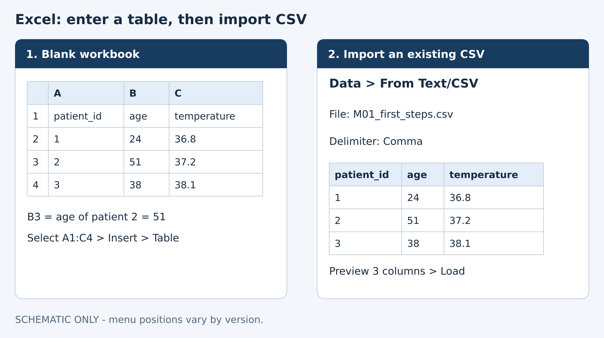

# نخستین جدول در Excel

**سطح:** نخستین آشنایی · **مخاطب:** همهٔ دانشجویان

## ۱. صفحه را بشناسیم

Excel برنامهٔ کار با جدول است. هر فایل آن یک Workbook نام دارد و درون آن یک یا چند برگه یا Sheet داریم. برگه از خانه‌ها ساخته شده است. بالای ستون‌ها حرف‌های A، B، C و کنار سطرها شماره‌های ۱،۲،۳ را می‌بینید. خانهٔ B3 یعنی ستون B و سطر ۳.

شکل زیر شماتیک است؛ عکس برنامه نیست. جای دکمه‌ها بسته به نسخه و اندازهٔ پنجره فرق دارد، ولی نام انگلیسی ابزارها راهنمای پیدا کردن آن‌هاست.

## ۲. نخست با دست جدول را بسازید

۱. Excel را باز کنید. `Blank workbook` یعنی فایل خالی؛ آن را برگزینید.
۲. روی A1 بزنید، `patient_id` را بنویسید و کلید Tab را بزنید. نشانگر به B1 می‌رود. `age` و سپس در C1، `temperature` را بنویسید.
۳. روی A2 بزنید و نخستین سطر داده را وارد کنید: `1`، سپس Tab، سپس `24`، سپس Tab، سپس `36.8`.
۴. سطر دوم داده در A3 تا C3 برابر `2`، `51`، `37.2` و سطر سوم در A4 تا C4 برابر `3`، `38`، `38.1` است.
۵. عنوان ستون‌ها دادهٔ یک فرد نیست؛ سه فرد داریم، هرچند چهار سطر برگه پر شده است.

| خانه | نوشته | چگونه بخوانیم؟ |
|---|---|---|
| A1 | patient_id | نام ستون شناسه |
| B3 | 51 | سن نفر دوم |
| C4 | 38.1 | دمای نفر سوم |

فعلا نام ستون‌ها و همین سه سطر کافی است. میان داده‌ها عنوان، توضیح یا سطر خالی نگذارید. توضیح فارسی را در برگهٔ جدا بنویسید.

## ۳. جدول آماده را باز کنید

اگر ورود دستی دشوار بود، [فایل Excel آغازین](../data/M01_first_steps.xlsx) را دانلود کنید. از `File > Open > Browse` فایل را برگزینید. برگهٔ `first_steps` باید همین جدول را نشان دهد.

**برای CSV:** از `Data > From Text/CSV`، فایل [M01_first_steps.csv](../data/M01_first_steps.csv) را برگزینید. در پیش‌نمایش، Delimiter را Comma بگذارید؛ باید سه ستون جدا ببینید. سپس Load را بزنید. اگر `36.8` متن خوانده شد، در Power Query نوع ستون temperature را با `Change Type > Using Locale`، برابر Decimal Number و English (United States) بگذارید. تنظیم زبان برنامه و تنظیم جداکنندهٔ اعشار دو چیز جدا هستند.

## ۴. یک جدول قابل مرتب‌سازی بسازید

محدودهٔ A1:C4 را برگزینید؛ یعنی روی A1 بزنید و تا C4 بکشید. از `Insert > Table`، گزینهٔ `My table has headers` را روشن بگذارید و OK بزنید. اکنون سطر نخست عنوان است. روی پیکان age بزنید و `Sort Smallest to Largest` را برگزینید. ترتیب سن‌ها باید ۲۴،۳۸،۵۱ شود؛ شناسه و دمای هر نفر باید همراه همان سن جابه‌جا شوند.

تنها یک ستون را جدا از بقیه مرتب نکنید؛ پیوند سن و دمای افراد به هم می‌ریزد. با Ctrl+Z یک گام به عقب برگردید.

## ۵. ذخیره و بازکردن دوباره

`File > Save As > Browse` را باز کنید، پوشهٔ خود را برگزینید و نام `my_first_table.xlsx` را بدهید. پسوند xlsx قالب فایل Excel است. فایل را ببندید و دوباره باز کنید؛ سن نفر دوم باید ۵۱ و دمای او ۳۷٫۲ باشد.

## اگر چیزی درست نبود

| چیزی که می‌بینید | چه کنید؟ |
|---|---|
| همهٔ داده‌های CSV در یک ستون افتاده | از From Text/CSV دوباره بخوانید و Comma را برگزینید |
| عنوان فارسی یا عدد اعشاری درست خوانده نشده | جداکننده، رمزگذاری UTF-8 و نوع ستون را در پیش‌نمایش بررسی کنید |
| عدد به شکل تاریخ درآمده | به گام ورود برگردید؛ ستون را Number بگذارید و مقدار اصلی را دوباره وارد کنید |
| فایل روی کامپیوتر پیدا نمی‌شود | در پنجرهٔ Open پوشهٔ Downloads و نام فایل را بررسی کنید |

**آماده‌اید:** خانه، سطر، ستون و فایل را می‌شناسید و جدول سه‌نفری ساخته‌اید. هیچ محاسبهٔ آماری لازم نبود.

## فیلم همین گام

[Kevin Stratvert — Excel Tutorial for Beginners](https://www.youtube.com/watch?v=LgXzzu68j7M&t=90s)

**سطح:** مقدماتی. **دامنهٔ دیدن:** از ۱:۳۰ تا ۳:۴۱: شناخت خانه، سطر و ستون و ورود داده. بخش‌های فرمول، نمودار و PivotTable برای این درس لازم نیستند.

---

[درس پیش: انتخاب نرم‌افزار](../START.md) | [درس بعد: داده چیست؟](../lessons/L1-data-observation-variable.md)
