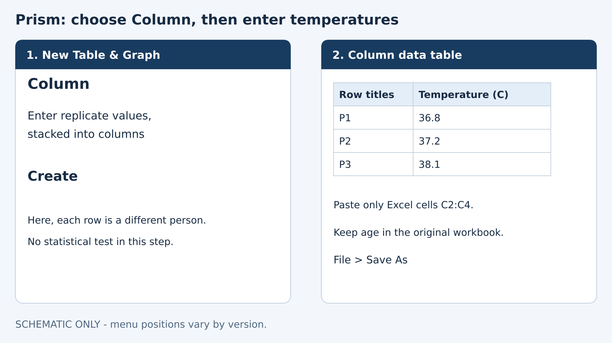

# نخستین جدول در GraphPad Prism

**سطح:** نخستین آشنایی · **مخاطب:** همهٔ دانشجویان

## ۱. اینجا چه می‌سازیم؟

برای شروع، تنها دمای همان سه نفر را وارد می‌کنیم. در Prism نوع جدول از آغاز بر پایهٔ پرسش برگزیده می‌شود. ساده‌ترین راه این گام، جدول **Column** است: یک ستون از عددهای هم‌جنس، مانند دمای بدن بر حسب درجهٔ سلسیوس.

شناسهٔ نفر را در عنوان سطر می‌گذاریم؛ سن را اکنون به این ستون نمی‌افزاییم. age و temperature دو کمیت جدا هستند و نباید زیر هم در یک ستون بیایند. فایل مادر سه‌ستونی را نگه دارید؛ این جدول Prism نمای کوچکی از همان داده است.

شکل شماتیک است؛ عکس برنامه نیست. گزینه‌های نسخهٔ نصب‌شده را با نام انگلیسی دنبال کنید.

## ۲. جدول خالی را بسازید

۱. Prism را باز کنید. در صفحهٔ آغاز `New Table & Graph` را برگزینید.
۲. از نوع جدول‌ها `Column` را برگزینید.
۳. گزینه‌ای با معنای `Enter replicate values, stacked into columns` را برگزینید؛ یعنی عددهای هر ستون زیر هم نوشته شوند. در این تمرین سه نفر جداگانه داریم؛ نام replicate در پنجره به معنی تکرار فنی یک نفر نیست.
۴. Create را بزنید. در بخش Data Tables یک جدول داده خواهید داشت. Navigator سمت چپ، فهرست جدول‌ها و نمودارهای فایل است.

## ۳. عنوان و عددها را بنویسید

عنوان نخستین ستون داده را `Temperature (C)` بگذارید. اگر جدول با عنوان A آغاز شده است، روی عنوان همان ستون بزنید و آن را عوض کنید. در Row titles، شناسه‌ها و در ستون عددی، دما را بنویسید:

| Row titles | Temperature (C) |
|---|---|
| P1 | 36.8 |
| P2 | 37.2 |
| P3 | 38.1 |

هر نفر تنها یک بار آمده است. ستون‌های خالی اضافه را پر نکنید. قرار نیست اکنون همهٔ خانه‌های پنجره پر شوند. روی سطر P2 مکث کنید: دمای او ۳۷٫۲ است.

## ۴. داده را از Excel کپی کنید

[فایل آغازین](../data/M01_first_steps.xlsx) را باز کنید. تنها خانه‌های C2 تا C4 را برگزینید؛ عنوان ستون و سن‌ها در این محدوده نباشند. Ctrl+C را بزنید. در Prism روی نخستین خانهٔ عددی ستون Temperature بزنید و Ctrl+V را بزنید. این سه عدد را **جای** مقدارهای همان ستون بنشانید؛ آن‌ها را زیر دادهٔ پیشین اضافه نکنید.

شناسه‌های P1 تا P3 را در Row titles بررسی کنید. اگر چند ستون عددی پر شده‌اند، به عقب برگردید؛ گسترهٔ کپی درست نبوده است. برای سه نفر، سه مقدار کافی است.

## ۵. نمودار را تنها ببینید

در Navigator به Graph مربوط به همین جدول بروید. نوع نمایش را نقطه‌ای بگذارید تا هر نفر با یک نقطه دیده شود. بسته به نسخه، پنجرهٔ Change Graph Type یا انتخاب نوع نمودار باز می‌شود. ارتفاع نقطه‌ها باید نزدیک ۳۶٫۸،۳۷٫۲ و ۳۸٫۱ باشد. رنگ و ظاهر اکنون هدف درس نیست؛ هیچ آزمونی را اجرا نکنید.

## ۶. ذخیره و بازکردن دوباره

از `File > Save As` نامی مانند `my_first_temperature` بدهید و قالب پیش‌فرض همان نسخه را نگه دارید. فایل را ببندید و از `File > Open` دوباره باز کنید. جدول و نمودار باید در Navigator باشند.

## اگر چیزی درست نبود

| مشکل | چه کنید؟ |
|---|---|
| نوع XY یا Contingency باز شده | یک جدول Column تازه بسازید؛ نوع جدول بخشی از معنای داده است |
| شناسه‌ها داخل ستون دما آمده‌اند | آن‌ها را به Row titles ببرید؛ ستون دما تنها عدد دما داشته باشد |
| شش عدد به‌جای سه عدد دارید | کپی دوم را زیر دادهٔ پیشین چسبانده‌اید؛ تنها سه سطر درست را نگه دارید |
| گزینهٔ replicate گیج‌کننده است | در این تمرین هر سطر یک نفر است؛ سه خوانش از یک نفر نداریم |

---

[درس پیش: انتخاب نرم‌افزار](../START.md) | [درس بعد: داده چیست؟](../lessons/L1-data-observation-variable.md)
