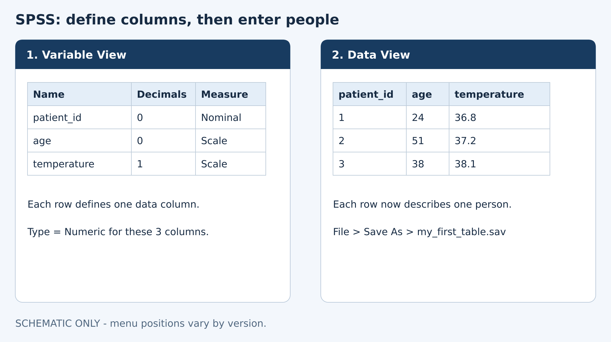

# نخستین جدول در SPSS — معرفی ستون‌ها، سپس نوشتن افراد

**سطح:** نخستین آشنایی · **مخاطب:** دانشجوی بدون پیشینهٔ آمار

در یادداشت درمانگاه، می‌دانیم ستون سن چه معنایی دارد. SPSS این پیش‌زمینه را ندارد؛ نخست به آن می‌گوییم چه ستون‌هایی داریم و سپس مقدارها را وارد می‌کنیم. با همین تفاوت، دو نمای اصلی برنامه روشن می‌شوند.

## یک جدول، دو نگاه

در یک New Dataset، پایین پنجره Data View و Variable View دیده می‌شوند. Data View همان جایی است که فردها و عددهایشان را می‌خوانیم. Variable View دربارهٔ خود ستون‌ها حرف می‌زند: نامشان چیست و چه چیزی در آن‌ها نوشته می‌شود؟

در بخش چپ شکل، هر سطر یک ستون را معرفی می‌کند. در بخش راست، هر سطر دربارهٔ یک نفر است. شکل شماتیک است و همهٔ گزینه‌های پنجره را نشان نمی‌دهد.

## به سه نام ساده نیاز داریم

در Variable View، سطر نخست را به patient_id می‌دهیم. این نام یعنی شمارهٔ شناسایی فرد. سطر دوم age و سطر سوم temperature است. نام کوتاه در Name می‌آید و توضیح بلندتر در Label قرار می‌گیرد.

| Name | Type | Decimals | Label | Measure |
|---|---|---|---|---|
| patient_id | Numeric | 0 | Patient identifier | Nominal |
| age | Numeric | 0 | Age in completed years | Scale |
| temperature | Numeric | 1 | Body temperature (C) | Scale |

Numeric می‌گوید در این ستون عدد می‌نویسیم. Decimals برابر ۱، دما را با یک رقم اعشار نشان می‌دهد؛ برای سن ثبت‌شده به سال کامل، صفر کافی است. در Measure، شمارهٔ فرد Nominal است و سن و دما Scale هستند. معنای کامل این نام‌ها را در درس ۲ می‌خوانیم؛ اکنون فقط می‌بینیم که شمارهٔ شناسایی و سن، نقش یکسانی ندارند.

## حالا افراد وارد جدول می‌شوند

با رفتن به Data View، همان سه نام بالای ستون‌ها دیده می‌شوند. دیگر عنوان‌ها را در سطر اول نمی‌نویسیم؛ سطر اول جای نفر نخست است:

| patient_id | age | temperature |
|---|---|---|
| 1 | 24 | 36.8 |
| 2 | 51 | 37.2 |
| 3 | 38 | 38.1 |

در این نما، سن نفر دوم در سطر دوم است و مقدارش ۵۱. اگر به Variable View برگردیم، همان سطر دوم دربارهٔ ستون age حرف می‌زند. عدد سطر به‌تنهایی کافی نیست؛ نام نمایی که در آن هستیم هم اهمیت دارد.

## جدول آماده چه کمکی می‌کند؟

[فایل سه‌نفری Excel](../data/M01_first_steps.xlsx) را می‌توان از File > Open > Data خواند. نوع فایل Excel و نام برگه first_steps است. گزینهٔ خواندن نام ستون‌ها از سطر نخست، سه عنوان را از سه سطر فردی جدا می‌کند.

پس از ورود، Variable View نشان می‌دهد SPSS چه نوعی برای ستون‌ها تشخیص داده است. مقایسه با جدول معرفی بالا کمک می‌کند از معنای داده مطمئن شویم. خواندن Excel راه دیگری برای رسیدن به همین سه نفر است؛ دو بار خواندن فایل، پژوهش را شش‌نفری نمی‌کند.

## ذخیرهٔ داده با ذخیرهٔ فرمان فرق دارد

File > Save As با نام my_first_table.sav، داده و ویژگی ستون‌ها را نگه می‌دارد. پسوند sav قالب دادهٔ SPSS است. با بازکردن دوبارهٔ فایل، سن و دمای فرد ۲ باید ۵۱ و ۳۷٫۲ مانده باشند.

در درس‌های بعد نام Syntax را هم می‌بینیم. Syntax نوشتهٔ کارهایی است که از SPSS می‌خواهیم انجام دهد. در این گام، کار با دو نمای جدول برای آغاز کافی است؛ پس از فهم کار، نگه‌داشتن روش آن به صورت فرمان هم آسان‌تر خواهد شد.

اگر دما بدون اعشار دیده شود، نخست Decimals را نگاه می‌کنیم. شکل نمایش عدد با خود مقدار یکی نیست؛ تغییر نمایش به‌تنهایی دلیل از دست رفتن اعشار نیست.

## فیلم همین گام

[Entering Data in SPSS: Variable View and Data View Explained](https://www.youtube.com/watch?v=1f8b9TjRS7g)

**سطح:** مقدماتی. **دامنهٔ دیدن:** فقط ساخت ستون‌ها و نوشتن سطرهای داده را دنبال کنید. پس از دیدن جدول ساخته‌شده به تمرین برگردید؛ تحلیل آماری در این گام نداریم.

---

[درس پیش: انتخاب نرم‌افزار](../START.md) | [درس بعد: داده چیست؟](../lessons/L1-data-observation-variable.md)
