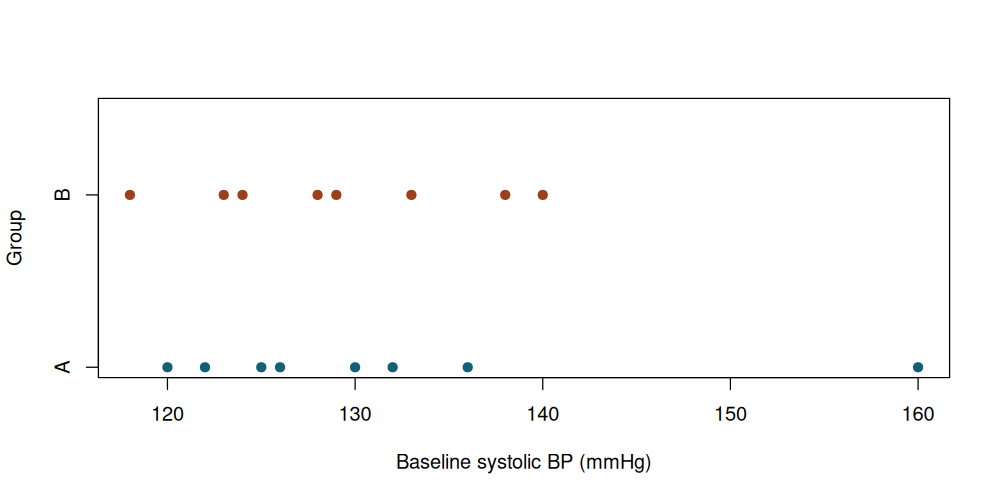
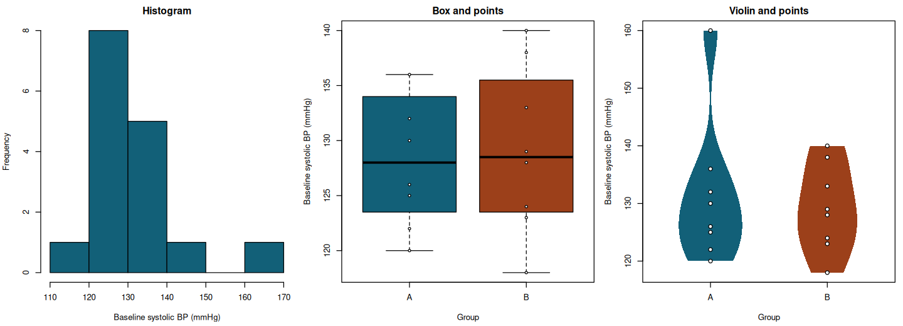

# ۸.۱ — توزیع فشار خون را چگونه ببینیم؟

در گروه A هفت فشار آغازین بین ۱۲۰ و ۱۳۶ mmHg هستند و یک فشار ۱۶۰ است. میانگین به‌تنهایی جای آن فرد را در نمونه نشان نمی‌دهد.

## یک مسئله از فایل تا گزارش

در روز صفر برای ۱۶ نفر فشار داریم. عدد ۱۳۰ دقیقاً روی مرز دو بازه قرار دارد.

بازه را از چپ بسته و از راست باز بگیرید. پس ۱۳۰ در [۱۳۰،۱۴۰) می‌افتد و ۱۲۰ در [۱۲۰،۱۳۰). شش شمار از بازهٔ ۱۱۰ تا کمتر از ۱۷۰ به‌ترتیب ۱، ۸، ۵، ۱، ۰ و ۱ است. جمع ۱۶، یعنی هر فرد یک بار شمرده شده است.

**گام کنترل.** در مجموع بازهٔ ۱۶۰ تا کمتر از ۱۷۰ یک نفر دارد. برای پیدا کردن گروه او، نمودار نقطه‌ای تفکیک‌شده بخوانید. هیستوگرام کل، شناسه و گروه فرد را نگه نمی‌دارد.

[Excel](../excel/L01.md) · [SPSS](../spss/L01.md) · [Prism](../prism/L01.md) · [R](../r/L01.md) · [Python](../python/L01.md)

## مقدماتی

در **نمودار نقطه‌ای** هر نقطه یک نفر است. برای نمونهٔ کوچک، این نمایش شمار افراد و فاصله‌ها را مستقیم نشان می‌دهد. اگر دو عدد یکی باشند، نقطه‌ها را روی هم بچینید یا کمی در راستای عمود جابه‌جا کنید تا مقدار عددی عوض نشود.

## متوسط

در **هیستوگرام** محور افقی بازه‌های عددی و محور عمودی شمار افراد در هر بازه است. با بازه‌های چپ‌بسته و راست‌باز و مرزهای ۱۲۰، ۱۳۰ و ۱۴۰، مقدار ۱۳۰ در بازهٔ ۱۳۰ تا کمتر از ۱۴۰ می‌افتد. هنگامی که دو گروه را در دو پنل می‌گذارید، مرزها و مقیاس عمودی را یکسان بگیرید. پهن‌تر کردن بازه‌ها شکل جزئی توزیع را می‌پوشاند و باریک‌تر کردنشان نمونهٔ کوچک را پراکنده نشان می‌دهد.

در نمودار **جعبه‌ای** خط میانی میانه است و جعبه از چارک اول تا سوم می‌رود. در روش Tukey، سبیل‌ها تا آخرین دادهٔ واقع در فاصلهٔ ۱٫۵ برابر دامنهٔ میان‌چارکی از جعبه می‌رسند. نقطهٔ بیرون سبیل را بررسی کنید و تصمیم دربارهٔ آن را با رجوع به دادهٔ اصلی بگیرید.

## پیشرفته

در **ویولن** پهنا شکل چگالی برآوردشده را نشان می‌دهد. پهنای هموارسازی می‌تواند قله‌ها را ادغام کند یا برآمدگی‌های کوچکی بسازد. پهنای ویولن به تنظیمات رسم هم وابسته است. در نمونهٔ هشت‌نفری، نمایش نقطه‌ها کنار ویولن به خواننده امکان می‌دهد داده و برآورد را با هم ببیند.

[درس پیش](../../M07-categorical-frequency-tables/lessons/L3-comparing-reporting.md) · [درس بعد](L2-groups-and-relationships.md)

در این شکل ویولن در دامنهٔ دادهٔ هر گروه بریده شده و پهنای هموارسازی هر دو گروه ۵ mmHg است.

## یک هیستوگرام را از روی فایل بازسازی کنیم

ستون day0 در فایل ۱۶ عدد دارد. قبل از رسم، مرزها را ۱۱۰، ۱۲۰، ۱۳۰، ۱۴۰، ۱۵۰، ۱۶۰ و ۱۷۰ انتخاب می‌کنیم. عدد ۱۱۸ در بازهٔ ۱۱۰ تا کمتر از ۱۲۰ قرار می‌گیرد. عدد ۱۲۰ از بازهٔ اول بیرون است و بازهٔ دوم را شروع می‌کند. برای ۱۳۰ هم همین تصمیم را در مرز بعدی می‌گیریم.

| بازهٔ mmHg | افراد گروه A | افراد گروه B | کل |
|---|---:|---:|---:|
| ۱۱۰ تا کمتر از ۱۲۰ | ۰ | ۱ | ۱ |
| ۱۲۰ تا کمتر از ۱۳۰ | ۴ | ۴ | ۸ |
| ۱۳۰ تا کمتر از ۱۴۰ | ۳ | ۲ | ۵ |
| ۱۴۰ تا کمتر از ۱۵۰ | ۰ | ۱ | ۱ |
| ۱۵۰ تا کمتر از ۱۶۰ | ۰ | ۰ | ۰ |
| ۱۶۰ تا کمتر از ۱۷۰ | ۱ | ۰ | ۱ |

جمع ستون آخر ۱۶ است. اگر ۱۵ شد، احتمالاً مقدارِ روی مرز را جا انداخته‌اید. اگر ۱۷ شد، احتمالاً یک مقدار در دو بازه شمرده شده است. بازهٔ خالی را از محور حذف نکنید، چون فاصلهٔ ۱۵۰ تا ۱۶۰ واقعاً بخشی از مقیاس است.

**مکث.** از هیستوگرام کل می‌فهمیم یک فشار در بازهٔ آخر هست. از کجا می‌فهمیم به کدام گروه تعلق دارد؟ هیستوگرام کل گروه را نگه نمی‌دارد. در نمودار نقطه‌ای تفکیک‌شده یا جدول بالا می‌فهمیم که آن فرد در A است. همین تفاوت به انتخاب نوع شکل کمک می‌کند.

اگر بخواهید اختلاف توزیع دو گروه را داوری کنید، نخست دادهٔ هر گروه را با تعداد و همان مرزها نشان دهید. با نمونهٔ هشت‌نفری، هر نفر سهم بزرگی از شکل دارد. برای نتیجه‌گیری دربارهٔ شکل توزیع جامعه به این نمودار کوچک تکیه نکنید.

## نمونهٔ حل‌شده

**جابه‌جایی مرز بازه.** برای فشار ۱۳۰ و مرزهای ۱۲۰، ۱۳۰ و ۱۴۰، در قرارداد [a,b) مقدار ۱۳۰ به بازهٔ دوم می‌رود. اگر نرم‌افزار مرز را از راست ببندد، همین مقدار در بازهٔ اول می‌افتد. کنار شکل قرارداد را بنویسید.

[۳۰ تمرین سطح‌بندی‌شده و حل‌ها](../exercises/L1.md)

## کار با نرم‌افزار

ابتدا [کارگاه عملی این ماژول](../software-workshop.md) را باز کنید تا فایل و محیط را آماده کنید. سپس خروجی نمونه را با این بخش بسنجید.

**خروجی برای مقایسه.** شمار بازهٔ [۱۲۰، ۱۳۰) باید ۸ باشد.

Excel

CSV را وارد کنید. با COUNTIFS روی day0 دو شرط >=120 و <130 را در یک فرمول وارد کنید. شمار هر بازه را در نمودار ستونیِ بدون فاصله نمایش دهید.

فیلم کمکی. [Microsoft، ساخت نمودار](https://www.youtube.com/watch?v=4Bma9ieavIg) — مقدماتی. بخش انتخاب داده و درج نمودار. برای تعیین قرارداد مرز هیستوگرام، متن درس را دنبال کنید.

SPSS

در Chart Builder یک Histogram برای day0 بسازید. برای کنترل دقیق بازه، در Compute Variable مقدار TRUNC(day0/10)*10 را بسازید و فراوانی مقدار ۱۲۰ را بخوانید.

GraphPad Prism

day0 را در جدول Column وارد کنید. از Frequency Distribution بازه‌های هم‌عرض انتخاب کنید. برای بازتولید قرارداد چپ‌بستهٔ درس، شمارها را از جدول محاسبه‌شده وارد XY یا Column کنید.

R

`d <- read.csv("data/M08_followup.csv")` سپس `hist(d$day0, breaks=seq(110,170,10), right=FALSE)`.

Python

`d = pd.read_csv("data/M08_followup.csv")` سپس `plt.hist(d.day0, bins=range(110, 171, 10))`. لبهٔ آخر در NumPy/Matplotlib بسته است و در این داده مقدار ۱۷۰ نداریم.

## خواندن و دیدن

[فیلم‌ها و مراجع نوشتاری هر پنج نرم‌افزار](../references.md#software-media)

- NIST/SEMATECH، بخش Histogram.
- [Khan Academy، ساخت هیستوگرام](https://www.khanacademy.org/v/histograms-intro) — مقدماتی. روی انتخاب بازه‌ها و شمار هر بازه تمرکز کنید.

