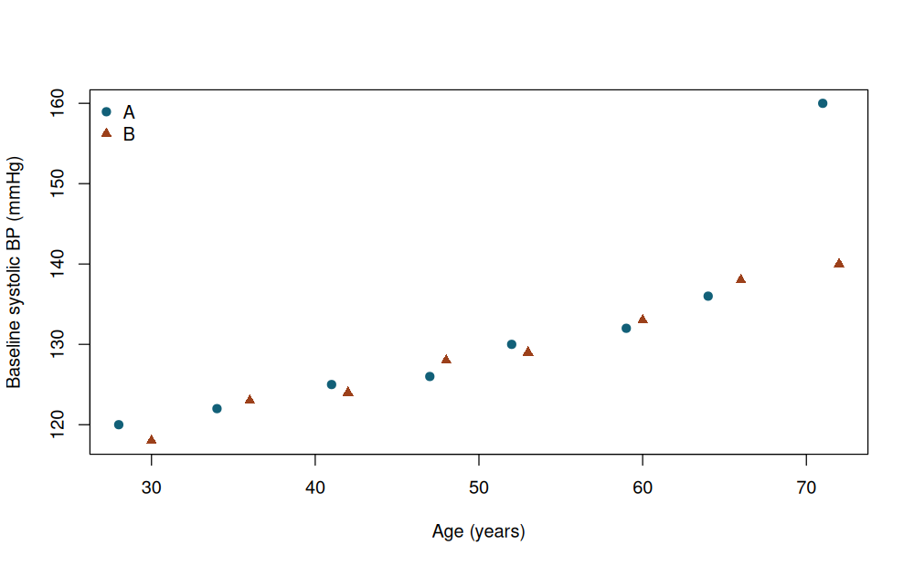
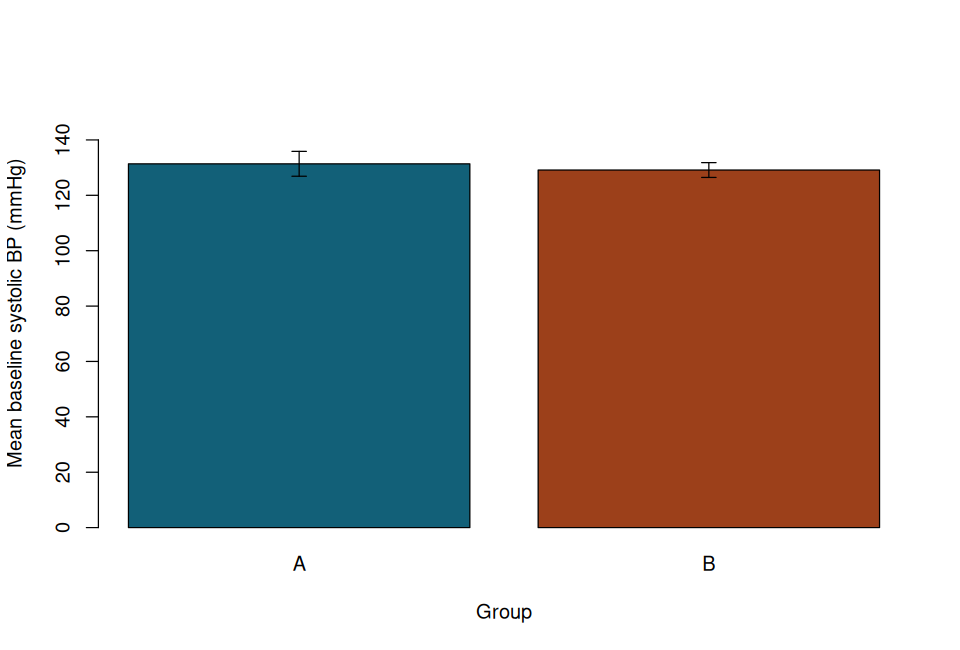

# ۸.۲ — گروه‌ها چقدر فرق دارند و سن چه نقشی دارد؟

میانگین فشار آغازین A برابر ۱۳۱٫۴ و میانگین B برابر ۱۲۹٫۱ mmHg است. نمودار گروهی باید نشان دهد که این دو خلاصه از چه مقدارهایی به دست آمده‌اند.

## یک مسئله از فایل تا گزارش

شناسهٔ ۸، سن ۷۱ و فشار ۱۶۰ دارد.

در نمودار پراکنش، همین سطر یک نقطهٔ (۷۱،۱۶۰) در گروه A می‌سازد. ۷۱ را روی محور سن و ۱۶۰ را روی محور فشار پیدا کنید. اگر ستون‌ها را جدا مرتب کنید، ممکن است سن و فشار دو فرد را اشتباهی به هم وصل کنید.

**گام کنترل.** اگر خلاصهٔ میانگین ± SE می‌سازید، آن را با نمودار پراکندگی افراد اشتباه نگیرید. در A میانگین ۱۳۱٫۳۷۵ و SE حدود ۴٫۴۹۲ است. زیرنویس مشخص کند میله SD، SE یا CI است.

[Excel](../excel/L02.md) · [SPSS](../spss/L02.md) · [Prism](../prism/L02.md) · [R](../r/L02.md) · [Python](../python/L02.md)

## مقدماتی

نقطه‌های افراد را برای هر گروه جدا رسم کنید. برای شمار افراد یا درصد گروه‌ها، نمودار میله‌ای با محور آغازشده از صفر مقایسه را خوانا می‌کند. برای فشار خون، نمایش نقطه‌ها یا جعبه همراه نقطه‌ها شکل پراکندگی را نیز نشان می‌دهد.

## متوسط

اگر میانگین را با میلهٔ خطا گزارش می‌کنید، در زیرنویس مشخص کنید میله چه چیزی را نمایش می‌دهد. **SD** پراکندگی مقدارهای فردی، **SE** خطای استاندارد برآورد میانگین و **CI** فاصلهٔ اطمینان برای پارامتر بر اساس روش و پیش‌فرض‌های آن است. در نمونهٔ کوچک، فاصلهٔ اطمینان معمول میانگین با توزیع t به پیش‌فرض‌هایش وابسته است. برای اختلاف گروه‌ها، خود اختلاف را با فاصلهٔ اطمینان مناسب برآورد کنید.

## پیشرفته

در **نمودار پراکنش** هر نقطه یک جفت اندازه‌گیری از یک نفر است. سن را روی محور افقی و فشار آغازین را روی محور عمودی بگذارید و گروه را با شکل یا رنگ تمایز دهید. برای داوری دربارهٔ رابطه، راستا، خمیدگی و نقطه‌های دورافتاده را در هر گروه ببینید. همبستگی یا خط روند به‌تنهایی اثر علّی سن یا گروه را تعیین نمی‌کند.

[درس پیش](L1-distributions.md) · [درس بعد](L3-followup-and-table-one.md)

میله‌های خطا یک SE در هر جهت‌اند و در هر گروه ۸ نفر داریم.

## از هر سطر تا یک نقطه، و از نقطه‌ها تا یک خلاصه

فرد ۸ در فایل، ۷۱ سال سن و فشار آغازین ۱۶۰ دارد. در نمودار پراکنش، X=71 و Y=160 را در یک نقطه با علامت گروه A می‌گذاریم. اگر سن و فشار را جداگانه مرتب کنید، ممکن است ۷۱ را به فشار فرد دیگری وصل کنید. برای ساخت نمودار هر جفت را با شناسهٔ همان سطر بردارید.

حالا از سؤال رابطهٔ سن و فشار به سؤال دیگری برسیم. «در هر گروه میانگین فشار و دقت برآوردش چقدر است؟» در A، جمع هشت فشار ۱۰۵۱ است و میانگین ۱۳۱٫۳۷۵. SD نمونه‌ای تقریباً ۱۲٫۷۰۵ و SE برابر `12.705/√8≈4.492` است. اگر تصمیم گرفتیم شکل میانگین ± یک SE را نشان دهد، سرهای میلهٔ خطا حدود ۱۲۶٫۸۸۳ و ۱۳۵٫۸۶۷ خواهند بود.

| برچسب شکل | خواننده چه می‌بیند؟ |
|---|---|
| نقطه‌های فردی | خود فشارهای ثبت‌شده، از جمله ۱۶۰ |
| میانگین ± SD | میانگین و اندازه‌ای برای پراکندگی افراد |
| میانگین ± SE | میانگین و خطای استاندارد برآورد آن |
| فاصلهٔ اطمینان اختلاف | دامنهٔ عدم‌قطعیت برای اثر گروه با روش مشخص |

**مکث.** اگر دو شکل یکی میلهٔ SD و دیگری میلهٔ SE داشته باشند، می‌توانیم از کوتاه‌تر بودن یکی نتیجه بگیریم افرادش شبیه‌ترند؟ خیر. میله‌ها دو کمیت متفاوت را نمایش می‌دهند. زیرنویس نوع میله و n را روشن کند.

در یک گزارش توصیفی بنویسید «در هر گروه ۸ فرد ثبت شدند. نقطه‌ها فشارهای فردی‌اند؛ نشانهٔ خلاصه میانگین و میله‌ها ± یک SE را نشان می‌دهند.» برای ادعای فرق گروه‌ها، برآورد و فاصلهٔ مخصوص اختلاف را جدا بسازید.

## نمونهٔ حل‌شده

**گزارش نمودار میله‌ای با SE.** برای گروه A، از SD برابر ۱۲٫۷۰۵ و n=۸، SE حدود ۴٫۴۹ است. روی میلهٔ میانگین ۱۳۱٫۳۸، دو سر خط خطا حدود ۱۲۶٫۸۹ و ۱۳۵٫۸۷ هستند. زیرنویس بنویسد میانگین ± یک SE، با ۸ نفر.

[۳۰ تمرین سطح‌بندی‌شده و حل‌ها](../exercises/L2.md)

## کار با نرم‌افزار

ابتدا [کارگاه عملی این ماژول](../software-workshop.md) را باز کنید تا فایل و محیط را آماده کنید. سپس خروجی نمونه را با این بخش بسنجید.

**خروجی برای مقایسه.** در پراکنش، فرد ۷۱ سالهٔ A فشار ۱۶۰ دارد.

Excel

CSV را باز کنید، age و day0 را در نمودار XY به X و Y بدهید. برای نشانه‌های جدا، دو سری از ردیف‌های A و B اضافه کنید.

SPSS

در Chart Builder یک Scatter بسازید. age را در X، day0 را در Y و group را برای رنگ یا گروه‌بندی به کار ببرید.

GraphPad Prism

در XY، age را X بگذارید و دو سری Y برای A و B بسازید. در هر ردیف فقط سری همان گروه را پر کنید.

R

`plot(d$age, d$day0, pch=ifelse(d$group=="A",19,17))` پس از خواندن CSV اجرا شود.

Python

`for group, rows in d.groupby("group"): plt.scatter(rows.age, rows.day0, label=group)` سپس `plt.legend()`.

فیلم کمکی. [Microsoft Learn، رسم با Matplotlib](https://learn.microsoft.com/en-us/shows/machine-learning-for-beginners/how-to-visualize-data-with-matplotlib-machine-learning-for-beginners) — مقدماتی. روی ایجاد شکل و خواندن محورها تمرکز کنید.

## خواندن و دیدن

[فیلم‌ها و مراجع نوشتاری هر پنج نرم‌افزار](../references.md#software-media)

- OpenStax، بخش Scatter Plots.
- [Khan Academy، ساخت نمودار پراکنش](https://www.khanacademy.org/math/statistics-probability/describing-relationships-quantitative-data/introduction-to-scatterplots/v/constructing-scatter-plot) — مقدماتی. تا ساخت نقطه از یک جفت مقدار دنبال کنید.

