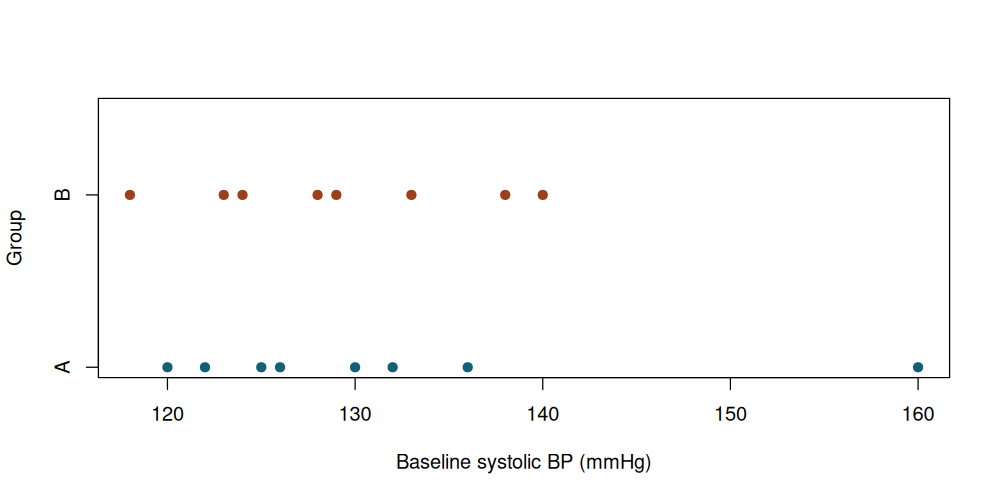
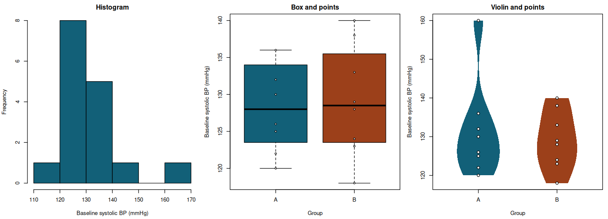
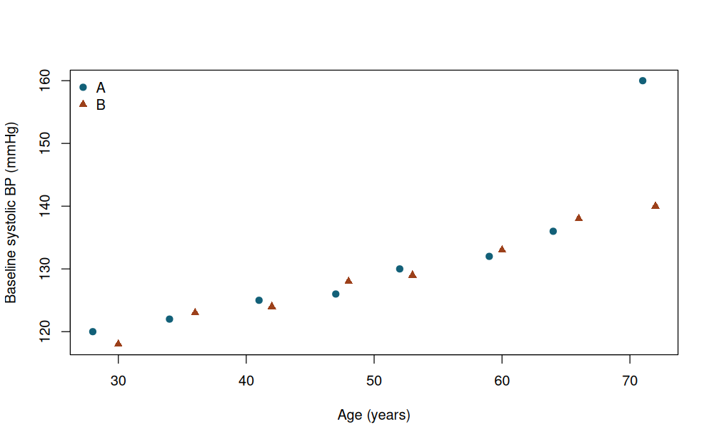
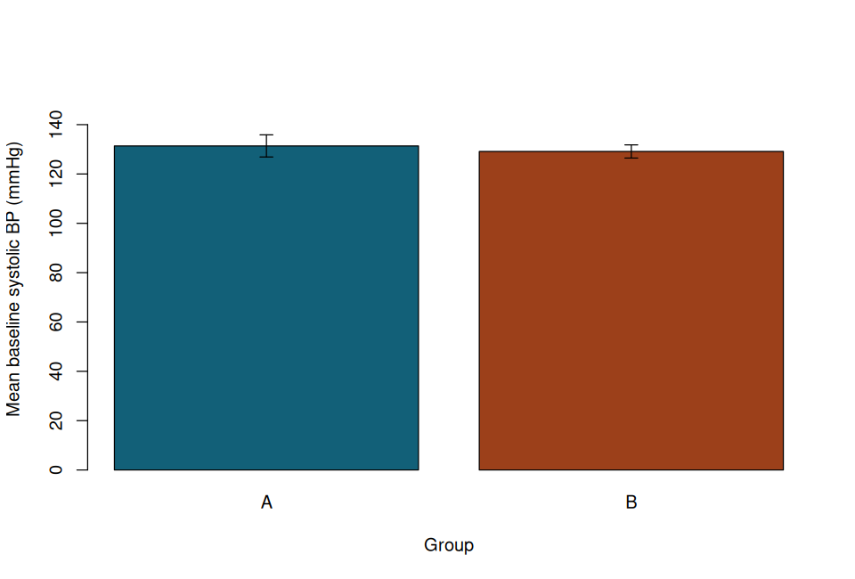
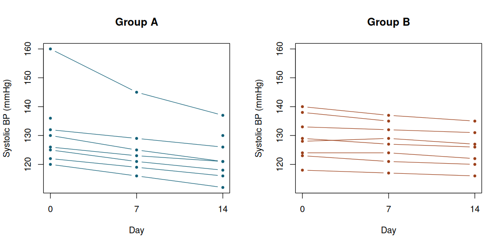

# M08 — از توزیع یک سنجه تا نمایش پیگیری هر فرد

با یک فایل ۱۶نفری کار می‌کنیم. ابتدا می‌پرسیم فشار آغازین چه توزیعی دارد. سپس رابطهٔ سن و فشار را به تفکیک گروه می‌بینیم. در پایان از روی تاریخچهٔ فرد و مخرج‌های معتبر می‌خوانیم چه تغییری قابل محاسبه است. هر شکل باید به یک پرسش پاسخ دهد و دادهٔ لازم برای همان پرسش را نشان دهد.

[توزیع فشار آغازین](#section-1) · [مقایسهٔ دو گروه و نمایش رابطه](#section-2) · [فشار در پیگیری و جدول آغاز مطالعه](#section-3) · [تمرین‌ها و نرم‌افزار](#practice)

## 1. توزیع فشار آغازین

پیش از افزودن گروه‌ها، محور و بازه‌های یک سنجه را درست تعریف کنید.

در گروه A هفت فشار آغازین بین ۱۲۰ و ۱۳۶ mmHg هستند و یک فشار ۱۶۰ است. میانگین به‌تنهایی جای آن فرد را در نمونه نشان نمی‌دهد.

### یک مسئله از فایل تا گزارش

در روز صفر برای ۱۶ نفر فشار داریم. عدد ۱۳۰ دقیقاً روی مرز دو بازه قرار دارد.

بازه را از چپ بسته و از راست باز بگیرید. پس ۱۳۰ در [۱۳۰،۱۴۰) می‌افتد و ۱۲۰ در [۱۲۰،۱۳۰). شش شمار از بازهٔ ۱۱۰ تا کمتر از ۱۷۰ به‌ترتیب ۱، ۸، ۵، ۱، ۰ و ۱ است. جمع ۱۶، یعنی هر فرد یک بار شمرده شده است.

**گام کنترل.** در مجموع بازهٔ ۱۶۰ تا کمتر از ۱۷۰ یک نفر دارد. برای پیدا کردن گروه او، نمودار نقطه‌ای تفکیک‌شده بخوانید. هیستوگرام کل، شناسه و گروه فرد را نگه نمی‌دارد.

[Excel](../excel/L01.md) · [SPSS](../spss/L01.md) · [Prism](../prism/L01.md) · [R](../r/L01.md) · [Python](../python/L01.md)

### مقدماتی

در **نمودار نقطه‌ای** هر نقطه یک نفر است. برای نمونهٔ کوچک، این نمایش شمار افراد و فاصله‌ها را مستقیم نشان می‌دهد. اگر دو عدد یکی باشند، نقطه‌ها را روی هم بچینید یا کمی در راستای عمود جابه‌جا کنید تا مقدار عددی عوض نشود.

### متوسط

در **هیستوگرام** محور افقی بازه‌های عددی و محور عمودی شمار افراد در هر بازه است. با بازه‌های چپ‌بسته و راست‌باز و مرزهای ۱۲۰، ۱۳۰ و ۱۴۰، مقدار ۱۳۰ در بازهٔ ۱۳۰ تا کمتر از ۱۴۰ می‌افتد. هنگامی که دو گروه را در دو پنل می‌گذارید، مرزها و مقیاس عمودی را یکسان بگیرید. پهن‌تر کردن بازه‌ها شکل جزئی توزیع را می‌پوشاند و باریک‌تر کردنشان نمونهٔ کوچک را پراکنده نشان می‌دهد.

در نمودار **جعبه‌ای** خط میانی میانه است و جعبه از چارک اول تا سوم می‌رود. در روش Tukey، سبیل‌ها تا آخرین دادهٔ واقع در فاصلهٔ ۱٫۵ برابر دامنهٔ میان‌چارکی از جعبه می‌رسند. نقطهٔ بیرون سبیل را بررسی کنید و تصمیم دربارهٔ آن را با رجوع به دادهٔ اصلی بگیرید.

### پیشرفته

در **ویولن** پهنا شکل چگالی برآوردشده را نشان می‌دهد. پهنای هموارسازی می‌تواند قله‌ها را ادغام کند یا برآمدگی‌های کوچکی بسازد. پهنای ویولن به تنظیمات رسم هم وابسته است. در نمونهٔ هشت‌نفری، نمایش نقطه‌ها کنار ویولن به خواننده امکان می‌دهد داده و برآورد را با هم ببیند.

در این شکل ویولن در دامنهٔ دادهٔ هر گروه بریده شده و پهنای هموارسازی هر دو گروه ۵ mmHg است.

### یک هیستوگرام را از روی فایل بازسازی کنیم

ستون day0 در فایل ۱۶ عدد دارد. قبل از رسم، مرزها را ۱۱۰، ۱۲۰، ۱۳۰، ۱۴۰، ۱۵۰، ۱۶۰ و ۱۷۰ انتخاب می‌کنیم. عدد ۱۱۸ در بازهٔ ۱۱۰ تا کمتر از ۱۲۰ قرار می‌گیرد. عدد ۱۲۰ از بازهٔ اول بیرون است و بازهٔ دوم را شروع می‌کند. برای ۱۳۰ هم همین تصمیم را در مرز بعدی می‌گیریم.

| بازهٔ mmHg | افراد گروه A | افراد گروه B | کل |
|---|---:|---:|---:|
| ۱۱۰ تا کمتر از ۱۲۰ | ۰ | ۱ | ۱ |
| ۱۲۰ تا کمتر از ۱۳۰ | ۴ | ۴ | ۸ |
| ۱۳۰ تا کمتر از ۱۴۰ | ۳ | ۲ | ۵ |
| ۱۴۰ تا کمتر از ۱۵۰ | ۰ | ۱ | ۱ |
| ۱۵۰ تا کمتر از ۱۶۰ | ۰ | ۰ | ۰ |
| ۱۶۰ تا کمتر از ۱۷۰ | ۱ | ۰ | ۱ |

جمع ستون آخر ۱۶ است. اگر ۱۵ شد، احتمالاً مقدارِ روی مرز را جا انداخته‌اید. اگر ۱۷ شد، احتمالاً یک مقدار در دو بازه شمرده شده است. بازهٔ خالی را از محور حذف نکنید، چون فاصلهٔ ۱۵۰ تا ۱۶۰ واقعاً بخشی از مقیاس است.

**مکث.** از هیستوگرام کل می‌فهمیم یک فشار در بازهٔ آخر هست. از کجا می‌فهمیم به کدام گروه تعلق دارد؟ هیستوگرام کل گروه را نگه نمی‌دارد. در نمودار نقطه‌ای تفکیک‌شده یا جدول بالا می‌فهمیم که آن فرد در A است. همین تفاوت به انتخاب نوع شکل کمک می‌کند.

اگر بخواهید اختلاف توزیع دو گروه را داوری کنید، نخست دادهٔ هر گروه را با تعداد و همان مرزها نشان دهید. با نمونهٔ هشت‌نفری، هر نفر سهم بزرگی از شکل دارد. برای نتیجه‌گیری دربارهٔ شکل توزیع جامعه به این نمودار کوچک تکیه نکنید.

### نمونهٔ حل‌شده

**جابه‌جایی مرز بازه.** برای فشار ۱۳۰ و مرزهای ۱۲۰، ۱۳۰ و ۱۴۰، در قرارداد [a,b) مقدار ۱۳۰ به بازهٔ دوم می‌رود. اگر نرم‌افزار مرز را از راست ببندد، همین مقدار در بازهٔ اول می‌افتد. کنار شکل قرارداد را بنویسید.

[۳۰ تمرین سطح‌بندی‌شده و حل‌ها](../exercises/L1.md)

### کار با نرم‌افزار

ابتدا [کارگاه عملی این ماژول](../software-workshop.md) را باز کنید تا فایل و محیط را آماده کنید. سپس خروجی نمونه را با این بخش بسنجید.

**خروجی برای مقایسه.** شمار بازهٔ [۱۲۰، ۱۳۰) باید ۸ باشد.

Excel

CSV را وارد کنید. با COUNTIFS روی day0 دو شرط >=120 و <130 را در یک فرمول وارد کنید. شمار هر بازه را در نمودار ستونیِ بدون فاصله نمایش دهید.

فیلم کمکی. [Microsoft، ساخت نمودار](https://www.youtube.com/watch?v=4Bma9ieavIg) — مقدماتی. بخش انتخاب داده و درج نمودار. برای تعیین قرارداد مرز هیستوگرام، متن درس را دنبال کنید.

SPSS

در Chart Builder یک Histogram برای day0 بسازید. برای کنترل دقیق بازه، در Compute Variable مقدار TRUNC(day0/10)*10 را بسازید و فراوانی مقدار ۱۲۰ را بخوانید.

GraphPad Prism

day0 را در جدول Column وارد کنید. از Frequency Distribution بازه‌های هم‌عرض انتخاب کنید. برای بازتولید قرارداد چپ‌بستهٔ درس، شمارها را از جدول محاسبه‌شده وارد XY یا Column کنید.

R

`d <- read.csv("data/M08_followup.csv")` سپس `hist(d$day0, breaks=seq(110,170,10), right=FALSE)`.

Python

`d = pd.read_csv("data/M08_followup.csv")` سپس `plt.hist(d.day0, bins=range(110, 171, 10))`. لبهٔ آخر در NumPy/Matplotlib بسته است و در این داده مقدار ۱۷۰ نداریم.

### خواندن و دیدن

[فیلم‌ها و مراجع نوشتاری هر پنج نرم‌افزار](../references.md#software-media)

- NIST/SEMATECH، بخش Histogram.
- [Khan Academy، ساخت هیستوگرام](https://www.khanacademy.org/v/histograms-intro) — مقدماتی. روی انتخاب بازه‌ها و شمار هر بازه تمرکز کنید.

## 2. مقایسهٔ دو گروه و نمایش رابطه

حالا گروه و سن را وارد تصویر کنید و داده‌های فردی را حفظ کنید.

میانگین فشار آغازین A برابر ۱۳۱٫۴ و میانگین B برابر ۱۲۹٫۱ mmHg است. نمودار گروهی باید نشان دهد که این دو خلاصه از چه مقدارهایی به دست آمده‌اند.

### یک مسئله از فایل تا گزارش

شناسهٔ ۸، سن ۷۱ و فشار ۱۶۰ دارد.

در نمودار پراکنش، همین سطر یک نقطهٔ (۷۱،۱۶۰) در گروه A می‌سازد. ۷۱ را روی محور سن و ۱۶۰ را روی محور فشار پیدا کنید. اگر ستون‌ها را جدا مرتب کنید، ممکن است سن و فشار دو فرد را اشتباهی به هم وصل کنید.

**گام کنترل.** اگر خلاصهٔ میانگین ± SE می‌سازید، آن را با نمودار پراکندگی افراد اشتباه نگیرید. در A میانگین ۱۳۱٫۳۷۵ و SE حدود ۴٫۴۹۲ است. زیرنویس مشخص کند میله SD، SE یا CI است.

[Excel](../excel/L02.md) · [SPSS](../spss/L02.md) · [Prism](../prism/L02.md) · [R](../r/L02.md) · [Python](../python/L02.md)

### مقدماتی

نقطه‌های افراد را برای هر گروه جدا رسم کنید. برای شمار افراد یا درصد گروه‌ها، نمودار میله‌ای با محور آغازشده از صفر مقایسه را خوانا می‌کند. برای فشار خون، نمایش نقطه‌ها یا جعبه همراه نقطه‌ها شکل پراکندگی را نیز نشان می‌دهد.

### متوسط

اگر میانگین را با میلهٔ خطا گزارش می‌کنید، در زیرنویس مشخص کنید میله چه چیزی را نمایش می‌دهد. **SD** پراکندگی مقدارهای فردی، **SE** خطای استاندارد برآورد میانگین و **CI** فاصلهٔ اطمینان برای پارامتر بر اساس روش و پیش‌فرض‌های آن است. در نمونهٔ کوچک، فاصلهٔ اطمینان معمول میانگین با توزیع t به پیش‌فرض‌هایش وابسته است. برای اختلاف گروه‌ها، خود اختلاف را با فاصلهٔ اطمینان مناسب برآورد کنید.

### پیشرفته

در **نمودار پراکنش** هر نقطه یک جفت اندازه‌گیری از یک نفر است. سن را روی محور افقی و فشار آغازین را روی محور عمودی بگذارید و گروه را با شکل یا رنگ تمایز دهید. برای داوری دربارهٔ رابطه، راستا، خمیدگی و نقطه‌های دورافتاده را در هر گروه ببینید. همبستگی یا خط روند به‌تنهایی اثر علّی سن یا گروه را تعیین نمی‌کند.

میله‌های خطا یک SE در هر جهت‌اند و در هر گروه ۸ نفر داریم.

### از هر سطر تا یک نقطه، و از نقطه‌ها تا یک خلاصه

فرد ۸ در فایل، ۷۱ سال سن و فشار آغازین ۱۶۰ دارد. در نمودار پراکنش، X=71 و Y=160 را در یک نقطه با علامت گروه A می‌گذاریم. اگر سن و فشار را جداگانه مرتب کنید، ممکن است ۷۱ را به فشار فرد دیگری وصل کنید. برای ساخت نمودار هر جفت را با شناسهٔ همان سطر بردارید.

حالا از سؤال رابطهٔ سن و فشار به سؤال دیگری برسیم. «در هر گروه میانگین فشار و دقت برآوردش چقدر است؟» در A، جمع هشت فشار ۱۰۵۱ است و میانگین ۱۳۱٫۳۷۵. SD نمونه‌ای تقریباً ۱۲٫۷۰۵ و SE برابر `12.705/√8≈4.492` است. اگر تصمیم گرفتیم شکل میانگین ± یک SE را نشان دهد، سرهای میلهٔ خطا حدود ۱۲۶٫۸۸۳ و ۱۳۵٫۸۶۷ خواهند بود.

| برچسب شکل | خواننده چه می‌بیند؟ |
|---|---|
| نقطه‌های فردی | خود فشارهای ثبت‌شده، از جمله ۱۶۰ |
| میانگین ± SD | میانگین و اندازه‌ای برای پراکندگی افراد |
| میانگین ± SE | میانگین و خطای استاندارد برآورد آن |
| فاصلهٔ اطمینان اختلاف | دامنهٔ عدم‌قطعیت برای اثر گروه با روش مشخص |

**مکث.** اگر دو شکل یکی میلهٔ SD و دیگری میلهٔ SE داشته باشند، می‌توانیم از کوتاه‌تر بودن یکی نتیجه بگیریم افرادش شبیه‌ترند؟ خیر. میله‌ها دو کمیت متفاوت را نمایش می‌دهند. زیرنویس نوع میله و n را روشن کند.

در یک گزارش توصیفی بنویسید «در هر گروه ۸ فرد ثبت شدند. نقطه‌ها فشارهای فردی‌اند؛ نشانهٔ خلاصه میانگین و میله‌ها ± یک SE را نشان می‌دهند.» برای ادعای فرق گروه‌ها، برآورد و فاصلهٔ مخصوص اختلاف را جدا بسازید.

### نمونهٔ حل‌شده

**گزارش نمودار میله‌ای با SE.** برای گروه A، از SD برابر ۱۲٫۷۰۵ و n=۸، SE حدود ۴٫۴۹ است. روی میلهٔ میانگین ۱۳۱٫۳۸، دو سر خط خطا حدود ۱۲۶٫۸۹ و ۱۳۵٫۸۷ هستند. زیرنویس بنویسد میانگین ± یک SE، با ۸ نفر.

[۳۰ تمرین سطح‌بندی‌شده و حل‌ها](../exercises/L2.md)

### کار با نرم‌افزار

ابتدا [کارگاه عملی این ماژول](../software-workshop.md) را باز کنید تا فایل و محیط را آماده کنید. سپس خروجی نمونه را با این بخش بسنجید.

**خروجی برای مقایسه.** در پراکنش، فرد ۷۱ سالهٔ A فشار ۱۶۰ دارد.

Excel

CSV را باز کنید، age و day0 را در نمودار XY به X و Y بدهید. برای نشانه‌های جدا، دو سری از ردیف‌های A و B اضافه کنید.

SPSS

در Chart Builder یک Scatter بسازید. age را در X، day0 را در Y و group را برای رنگ یا گروه‌بندی به کار ببرید.

GraphPad Prism

در XY، age را X بگذارید و دو سری Y برای A و B بسازید. در هر ردیف فقط سری همان گروه را پر کنید.

R

`plot(d$age, d$day0, pch=ifelse(d$group=="A",19,17))` پس از خواندن CSV اجرا شود.

Python

`for group, rows in d.groupby("group"): plt.scatter(rows.age, rows.day0, label=group)` سپس `plt.legend()`.

فیلم کمکی. [Microsoft Learn، رسم با Matplotlib](https://learn.microsoft.com/en-us/shows/machine-learning-for-beginners/how-to-visualize-data-with-matplotlib-machine-learning-for-beginners) — مقدماتی. روی ایجاد شکل و خواندن محورها تمرکز کنید.

### خواندن و دیدن

[فیلم‌ها و مراجع نوشتاری هر پنج نرم‌افزار](../references.md#software-media)

- OpenStax، بخش Scatter Plots.
- [Khan Academy، ساخت نمودار پراکنش](https://www.khanacademy.org/math/statistics-probability/describing-relationships-quantitative-data/introduction-to-scatterplots/v/constructing-scatter-plot) — مقدماتی. تا ساخت نقطه از یک جفت مقدار دنبال کنید.

## 3. فشار در پیگیری و جدول آغاز مطالعه

نمودار زمان باید شناسهٔ فرد و فاصلهٔ گمشده را درست نگه دارد.

برای فرد ۷، فشار روز صفر ۱۳۶ و فشار روز ۱۴ برابر ۱۳۰ mmHg است. روز ۷ ثبت نشده است. شیب مسیر بین دو مقدار ثبت‌شده به‌تنهایی فشار روز ۷ را تعیین نمی‌کند.

### یک مسئله از فایل تا گزارش

در گروه B برای فرد ۱۵ فشار روز ۱۴ خالی است.

برای نمودار زمانی، همان فرد را در هر نوبت دنبال کنید. در خط فرد ۱۵ در روز ۱۴ نقطه نداریم. برای تغییر زوجی، به هر فرد دارای روز صفر و ۱۴ یک اختلاف بدهید. هفت تغییر جمعاً −۱۸ و میانگین تغییر −۲٫۵۷۱ هستند.

**گام کنترل.** کم‌کردن میانگین روز ۱۴ از روز صفر با نمونه‌های متفاوت، پرسش دیگری را جواب می‌دهد. کنار خلاصه بنویسید هفت جفت کامل از هشت نفر داریم و عدد را با گزارش جدول آغاز مخلوط نکنید.

[Excel](../excel/L03.md) · [SPSS](../spss/L03.md) · [Prism](../prism/L03.md) · [R](../r/L03.md) · [Python](../python/L03.md)

### مقدماتی

در **نمودار خطی** محور افقی زمان است. برای دیدن پیگیری فردی، تنها نقطه‌های همان فرد را با خط به هم وصل کنید. در این تمرین برای نوبت گمشده شکاف بگذارید تا نوبتِ بدون اندازه‌گیری پیدا باشد.

### متوسط

کنار خلاصهٔ هر روز، شمار مقدارهای موجود را بنویسید. تفاوت میانگین روز صفر و روز ۱۴ وقتی شمار افراد متفاوت است، از تغییر میانگین در افراد دارای هر دو اندازه‌گیری جداست. برای خلاصهٔ تغییر زوجی، ابتدا در هر فرد روز صفر را از روز ۱۴ کم کنید، سپس تغییرها را خلاصه کنید.

### پیشرفته

**جدول ۱** ویژگی‌های آغاز مطالعه را به تفکیک گروه گزارش می‌کند. در این نمونه برای سن و فشار آغازین میانگین و انحراف معیار نمونه‌ای را با مقیاس بنویسید. برای متغیر کیفی شمار و درصد با مخرج روشن بیاورید و دادهٔ گمشده را جدا ثبت کنید. روزهای ۷ و ۱۴ پیامد پیگیری‌اند و در جدول جداگانه گزارش می‌شوند.

| ویژگی آغاز | A، ۸ نفر | B، ۸ نفر |
|---|---:|---:|
| سن، میانگین (SD)، سال | ۴۹٫۵ (۱۴٫۹) | ۵۰٫۹ (۱۴٫۷) |
| فشار سیستولی، میانگین (SD)، mmHg | ۱۳۱٫۴ (۱۲٫۷) | ۱۲۹٫۱ (۷٫۶) |

### چرا میانگین‌های روزها را مستقیماً کم نکنیم؟

در گروه B، فرد ۱۵ روز صفر فشار ۱۳۸ دارد، ولی روز ۱۴ مقدار ندارد. میانگین روز صفر با ۸ نفر حدود ۱۲۹٫۱۲۵ و میانگین روز ۱۴ با ۷ نفر حدود ۱۲۵٫۲۸۶ است. کم‌کردن مستقیم، حدود −۳٫۸۳۹ می‌دهد. این مقایسهٔ دو میانگینِ در دسترس است.

برای پرسش «فشار همان افراد چقدر تغییر کرد؟»، فقط افراد دارای هر دو مقدار را بردارید و برای هر نفر روز ۱۴ منهای روز صفر را بگیرید. در B، برای فرد ۹ اختلاف ۱۱۶−۱۱۸=−۲ است. هفت تغییر به ترتیب −۲، −۳، −۲، −۱، −۳، −۲ و −۵ هستند. مجموع −۱۸ است و میانگین تغییر −۱۸/۷≈−۲٫۵۷۱. این بار هر نفر در هر دو سمت مقایسه حضور دارد.

**مکث.** آیا می‌توانیم برای فرد ۱۵ از فشار روز ۷ کمک بگیریم و آن را به جای روز ۱۴ در اختلاف بگذاریم؟ با این کار تعریف پیامد عوض می‌شود. برای M08، مقدار گمشده را خالی نگه می‌داریم و همراه عدد، شمار جفت‌های کامل را گزارش می‌کنیم. در تحلیل واقعی، علت و الگوی گمشدگی را نیز بررسی کنید.

برای **جدول ۱** پرسش فرق دارد. این جدول دربارهٔ آغاز مطالعه است. سن و فشار روز صفر را برای هشت نفر هر گروه خلاصه کنید و اگر دادهٔ آغاز وارد نشده، شمار آن را کنار متغیر بنویسید. تغییرهای روز ۱۴ در جدول جداگانه با عنوان و مخرج خود گزارش می‌شوند.

### نمونهٔ حل‌شده

**گزارش زوج‌ها.** در گروه B، اختلاف دو میانگین روز صفر و ۱۴ منفی ۳٫۸۴ است. وقتی نخست افراد دارای هر دو اندازه را انتخاب و تغییر هر نفر را حساب کنیم، میانگین تغییر منفی ۲٫۵۷ است. گزارش دوم مخرج ۷ زوج دارد.

[۳۰ تمرین سطح‌بندی‌شده و حل‌ها](../exercises/L3.md)

### کار با نرم‌افزار

ابتدا [کارگاه عملی این ماژول](../software-workshop.md) را باز کنید تا فایل و محیط را آماده کنید. سپس خروجی نمونه را با این بخش بسنجید.

**خروجی برای مقایسه.** برای گروه B شمارهای معتبر ۸، ۸ و ۷ است.

Excel

ستون‌های day0 تا day14 را برای هر فرد یک سری بگیرید. خانهٔ خالی را Gap بگذارید. شمار معتبر را با COUNT و SD آغاز را با STDEV.S گزارش کنید.

SPSS

در Restructure، day0 تا day14 را به یک ستون فشار و یک شاخص نوبت تبدیل کنید و id را نگه دارید. در نمودار چندخطی، نوبت را X و شناسه را سری بگیرید. در جدول خلاصه تعداد فشارهای غیرگمشده را با شمارش فشار بسنجید.

GraphPad Prism

از XY با X برابر ۰، ۷ و ۱۴ و یک Y برای هر فرد کمک بگیرید. فرد ۷ را با خانهٔ خالی روز ۷ وارد کنید. شمار معتبر و خلاصهٔ شروع مطالعه را برای ستون‌های روز صفر جدا بخوانید.

فیلم کمکی. [GraphPad، فیلم‌های شروع کار با Prism](https://www.graphpad.com/series/getting-started-in-prism) — مقدماتی. سراغ بخش ورود داده و رسم نمودار بروید.

R

`colSums(!is.na(subset(d, group=="B")[c("day0","day7","day14")]))` را اجرا کنید. شکل کامل در اسکریپت ماژول آمده است.

Python

`d.loc[d.group.eq("B"), ["day0","day7","day14"]].count()` را بخوانید. برای هر سطر یک خط رسم کنید و NaN را در بردار Y نگه دارید.

### خواندن و دیدن

[فیلم‌ها و مراجع نوشتاری هر پنج نرم‌افزار](../references.md#software-media)

- OpenStax، بخش Encoding Data That Change Over Time.
- [Khan Academy، نمودار خطی](https://www.khanacademy.org/math/statistics-probability/summarizing-quantitative-data/line-graphs/v/line-graphs) — مقدماتی. محور زمان و تفسیر شیب را ببینید.

## ۳۰ تمرین و مسئله و پنج مسیر نرم‌افزاری

[تمرین‌ها](../exercises/module.md) · [پاسخ تشریحی](../solutions/module.md)

[Excel](../excel/MODULE.md) · [SPSS](../spss/MODULE.md) · [GraphPad Prism](../prism/MODULE.md) · [R](../r/MODULE.md) · [Python](../python/MODULE.md)

[منابع نوشتاری و ویدیویی](../references.md) · [واژه‌نامه](../../../resources/glossary.md) · [گزارش وارسی](../VALIDATION.md)

