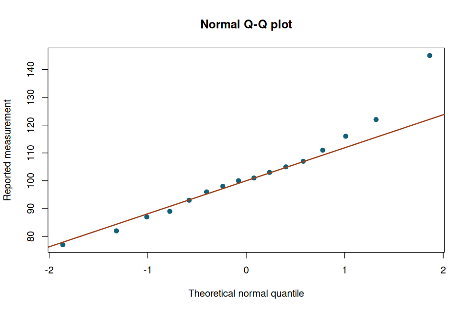

# M11 — توزیع‌های پیوسته و انتخاب مرجع

برای یک اندازه‌گیری پیوسته، باید پرسش را روی یک فاصله بگذاریم. نخست مقدار روی محور اصلی را به نمرهٔ استاندارد تبدیل می‌کنیم. سپس داده‌های مثبت و کج را می‌سنجیم و در پایان تفاوت میان توزیع داده و توزیع مرجع آماره را می‌خوانیم.

[چگالی، نرمال و نمرهٔ استاندارد](#section-1) · [سنجهٔ مثبت و توزیع نمایی](#section-2) · [توزیع مرجع و نمودار Q–Q](#section-3) · [تمرین‌ها و نرم‌افزار](#practice)

## 1. چگالی، نرمال و نمرهٔ استاندارد

مساحت زیر منحنی، احتمال یک بازه را می‌دهد.

### مسئلهٔ آغاز درس

در یک مدل آموزشی، میانگین اندازه ۱۰۰ و SD برابر ۱۵ است. از ۱۳۰ به بالا را می‌خواهیم.

اختلاف ۱۳۰ از ۱۰۰، ۳۰ است. آن را بر ۱۵ تقسیم کنید تا z=2 شود. اگر جدول یا نرم‌افزار مساحت چپ تا ۲ را داده، حدود ۰٫۹۷۷۲ می‌بینید. پرسش «به بالا» یعنی مکمل، ۰٫۰۲۲۸. احتمال یک مقدار دقیق در مدل پیوسته صفر است.

**پیش از اجرای نرم‌افزار.** صدک ۹۵ در چه سمتی از ۱۰۰ است و چه چیزی را باید از تابع بخواهید؟

حل تشریحی

بالاتر از میانگین است. بر خلاف محاسبهٔ احتمال از x، این بار احتمال ۰٫۹۵ و جهت چپ را می‌دهیم و x می‌گیریم. جواب حدود ۱۲۴٫۶۷ است.

[Excel](../excel/L01.md) · [SPSS](../spss/L01.md) · [GraphPad Prism](../prism/L01.md) · [R](../r/L01.md) · [Python](../python/L01.md)

### مقدماتی

زمان و فشار در مدل پیوسته می‌توانند هر عددی در یک بازه باشند. احتمال یک مقدار دقیق در مدل پیوسته صفر است. احتمال یک بازه مساحت زیر چگالی در آن بازه است. دقت گرد کردن دستگاه می‌تواند چند خوانش گزارش‌شده را برابر کند.

### متوسط

فرض کنید یک سنجهٔ آموزشی میانگین ۱۰۰ و انحراف معیار ۱۵ دارد و از توزیع نرمال پیروی می‌کند. مقدار ۱۳۰ دو انحراف معیار بالای میانگین است. با تبدیل `z = (x − μ)/σ` آن را به نرمال استاندارد با میانگین صفر و انحراف معیار یک می‌بریم. در این مدل احتمال بیشتر از ۱۳۰ حدود ۲٫۲۸٪ است.

### پیشرفته

تابع توزیع تجمعی F(x) احتمال X≤x را می‌دهد. احتمال فاصلهٔ a تا b برابر F(b)−F(a) است. صدک ۹۵ مقداری است که ۹۵٪ مساحت زیر آن است. در مدل درس این صدک حدود ۱۲۴٫۷ است. فاصلهٔ یک انحراف معیار پیرامون میانگین در مدل نرمال حدود ۶۸٫۳٪ احتمال دارد. شکل نرمال فرض مدل است و از نوشتن میانگین و SD نتیجه نمی‌شود.

### نمونهٔ حل‌شده

**بازهٔ نامتقارن.** در مدل درس، کران‌های ۸۵ و ۱۳۰ به zهای منفی یک و مثبت دو می‌رسند. اختلاف احتمال‌های تجمعی Φ(۲) و Φ(−۱)، حدود ۰٫۸۱۸۶ است.

[۳۰ تمرین سطح‌بندی‌شده و حل‌ها](../exercises/L1.md)

### کار با نرم‌افزار

ابتدا [کارگاه عملی این ماژول](../software-workshop.md) را باز کنید تا فایل و محیط را آماده کنید. سپس خروجی نمونه را با این بخش بسنجید.

**خروجی برای مقایسه.** احتمال دنبالهٔ راست در z=2 حدود ۰٫۰۲۲۸ است.

Excel

`=1-NORM.DIST(130,100,15,TRUE)` و `=NORM.INV(0.95,100,15)` برای صدک ۹۵.

SPSS

در Compute Variable از `1-CDF.NORMAL(130,100,15)` کمک بگیرید. z را با `(130-100)/15` کنترل کنید.

فیلم کمکی. [ساخت متغیر با Compute Variable](https://www.youtube.com/watch?v=xTstSbkP8Fg) — مقدماتی. روش واردکردن عبارت را ببینید و تابع CDF.NORMAL را از متن درس بردارید.

GraphPad Prism

در Prism 11 از تبدیل `Y=1-NORMDIST(Y,100,15,"left")` روی مقدار ۱۳۰ کمک بگیرید. جای واردکردن فرمول و عدد کنترل در کارگاه ماژول آمده است.

R

`pnorm(130,100,15,lower.tail=FALSE)` و `qnorm(.95,100,15)`.

Python

`from scipy.stats import norm` سپس `norm.sf(130,100,15)` و `norm.ppf(.95,100,15)`.

### خواندن و دیدن

[فیلم‌ها و مراجع نوشتاری هر پنج نرم‌افزار](../references.md#software-media)

- OpenStax، فصل The Normal Distribution، نرمال استاندارد.
- [Khan Academy، معرفی نمرهٔ z](https://www.khanacademy.org/v/z-score-introduction) — مقدماتی. مقیاس انحراف معیار را دنبال کنید.

## 2. سنجهٔ مثبت و توزیع نمایی

وقتی مقدار نمی‌تواند منفی باشد، شکل و کاربرد مدل را دوباره بررسی کنید.

### مسئلهٔ آغاز درس

در تمرین، میانهٔ یک اندازهٔ مثبت ۱۰ است و SD لگاریتم طبیعی آن ۰٫۵ است. در مسئلهٔ جدا، انتظار رخداد با نرخ دو در ساعت داریم.

برای مثال اول، اگر لگاریتم طبیعی اندازه نرمال باشد، میانگین خام exp(ln(10)+0.5²/2)≈11.33 است. برگشت exp(ln(10))=10 میانه را می‌دهد. در مثال انتظار نمایی، احتمال انتظار بیش از یک ساعت exp(−۲)≈۰٫۱۳۵۳ است. نرخ و زمان باید در مقیاس یکسان باشند.

**پیش از اجرای نرم‌افزار.** برای انتظار بیش از ۳۰ دقیقه، با نرخ دو در ساعت چه عددی داخل توان می‌رود؟

حل تشریحی

۳۰ دقیقه نیم ساعت است. حاصل ضرب نرخ و زمان ۱ است، پس exp(−1)≈0.3679.

[Excel](../excel/L02.md) · [SPSS](../spss/L02.md) · [GraphPad Prism](../prism/L02.md) · [R](../r/L02.md) · [Python](../python/L02.md)

### مقدماتی

زمان انتظار و بعضی اندازه‌گیری‌های آزمایشگاهی مثبت‌اند و گاهی دنبالهٔ بلندی در سمت راست دارند. برای انتخاب مدل، شکل توزیع و داستان تولید داده را با هم بررسی کنید.

### متوسط

اگر لگاریتم طبیعی X نرمال باشد، X لگ‌نرمال است. اگر میانگین لگاریتم log(10) و انحراف معیار آن ۰٫۵ باشد، میانهٔ X برابر ۱۰ و میانگین آن `exp(log(10) + 0.5²/2)`، حدود ۱۱٫۳۳ است. پس بازگرداندن میانگین لگاریتم به مقیاس اصلی، میانه را می‌دهد.

### پیشرفته

در یک فرایند پواسون با نرخ ثابت، زمان انتظار تا رخداد بعدی توزیع نمایی دارد. با نرخ λ=2 در ساعت، میانگین انتظار ۰٫۵ ساعت است و احتمال انتظار بیشتر از یک ساعت exp(−2) است. این مدل خاصیت بی‌حافظگی دارد. نرخ وابسته به زمان یا الگوی خوشه‌ای می‌تواند فرض مدل را تغییر دهد. لگ‌نرمال و نمایی هر دو مثبت‌اند، ولی شکل چگالی و سازوکارشان فرق دارد.

### نمونهٔ حل‌شده

**بقا در دو مقیاس.** نرخ ۲ در ساعت با ۱/۳۰ در دقیقه برابر است. احتمال انتظار بیش از ۳۰ دقیقه exp(−۳۰/۳۰) است. اگر نرخ را در ساعت نگه دارید، زمان را نیم ساعت وارد کنید و همان احتمال را بگیرید.

[۳۰ تمرین سطح‌بندی‌شده و حل‌ها](../exercises/L2.md)

### کار با نرم‌افزار

ابتدا [کارگاه عملی این ماژول](../software-workshop.md) را باز کنید تا فایل و محیط را آماده کنید. سپس خروجی نمونه را با این بخش بسنجید.

**خروجی برای مقایسه.** میانگین لگ‌نرمال ۱۱٫۳۳ و بقای نمایی در یک ساعت حدود ۰٫۱۳۵۳ است.

Excel

`=EXP(LN(10)+0.5^2/2)` و `=1-EXPON.DIST(1,2,TRUE)`.

SPSS

با Compute Variable دو عبارت `EXP(LN(10)+.5**2/2)` و `EXP(-2)` را وارد کنید.

GraphPad Prism

در جدول XY، X را زمان از صفر تا سه ساعت بگذارید. برای منحنی بقا، معادلهٔ Y=exp(−2X) را در Transform وارد کنید و Y در یک ساعت را بخوانید.

R

`exp(log(10)+.5^2/2)` و `pexp(1,2,lower.tail=FALSE)`.

Python

`from math import exp, log` و `from scipy.stats import expon`. سپس `exp(log(10)+.5**2/2)` و `expon.sf(1,scale=.5)`.

### خواندن و دیدن

[فیلم‌ها و مراجع نوشتاری هر پنج نرم‌افزار](../references.md#software-media)

- NIST/SEMATECH، بخش Lognormal Distribution.
- [Harvard Stat 110، توزیع نمایی](https://www.youtube.com/watch?v=bM6nFDjvEns) — پیشرفته. تعریف زمان انتظار و نرخ را ببینید.

## 3. توزیع مرجع و نمودار Q–Q

توزیع مرجع آزمون می‌تواند با توزیع نمونه متفاوت باشد.

### مسئلهٔ آغاز درس

در فایل تمرین ۱۶ اندازهٔ ساختگی داریم. پیش از آزمون می‌خواهیم شکل داده را با مدل نرمال مقایسه کنیم.

ابتدا مقدارهای مشاهده‌شده را مرتب کنید. برای رتبهٔ i، روی محور افقی یک صدک نرمال نظری مانند `Φ⁻¹((i−.5)/n)` بگذارید. روی محور عمودی مقدار واقعی همان رتبه را بگذارید. اگر شکل‌ها سازگار باشند، بیشتر نقاط نزدیک یک خط می‌افتند. دور شدن منظم در انتها می‌تواند به دنباله‌ها مربوط باشد. برای مقایسهٔ عددی جدا، صدک ۰٫۹۷۵ توزیع t با df=9 حدود ۲٫۲۶۲ است، چون t کوچک‌نمونه دنبالهٔ سنگین‌تری از نرمال دارد.

**پیش از اجرای نرم‌افزار.** آیا خط تقریباً صاف در Q-Q ثابت می‌کند که افراد مستقل‌اند؟

حل تشریحی

خیر. در Q-Q مقدارها مرتب شده‌اند و ترتیب زمانی یا شناسهٔ خوشه دیده نمی‌شود. استقلال از طرح و ساختار داده بررسی می‌شود.

[Excel](../excel/L03.md) · [SPSS](../spss/L03.md) · [GraphPad Prism](../prism/L03.md) · [R](../r/L03.md) · [Python](../python/L03.md)

### مقدماتی

در نمودار Q-Q، صدک‌های نظری را روی محور افقی و داده‌های مرتب را روی محور عمودی می‌گذاریم. اگر شکل داده به نرمال نزدیک باشد، نقطه‌ها در حدود یک خط می‌افتند. در نمونهٔ کوچک این داوری با نوسان همراه است.

### متوسط

در نمونهٔ مستقل نرمال، وقتی SD جامعه معلوم نیست، آمارهٔ `(mean − μ)/(s/sqrt(n))` توزیع t با n−1 درجه آزادی دارد. t از نرمال دنباله‌های سنگین‌تری دارد و با افزایش درجهٔ آزادی به آن نزدیک می‌شود. برای ۱۰ نفر، صدک ۹۷٫۵ توزیع t با ۹ درجه آزادی حدود ۲٫۲۶۲ است.

### پیشرفته

جمع مربع‌های k نرمال استاندارد مستقل، کای‌دو با k درجه آزادی است. در نمونهٔ نرمال مستقل، `(n−1)s²/σ²` کای‌دو با n−1 درجه آزادی دارد. تقسیم دو کای‌دوی مستقل که هر کدام بر درجهٔ آزادی خود تقسیم شده‌اند، F می‌دهد. F دو درجهٔ آزادی دارد و ترتیب آن‌ها مهم است.

در Q-Q خمیدگی نظام‌مند را کنار هیستوگرام و زمینهٔ اندازه‌گیری بررسی کنید. خروج از خط برای یک نقطه می‌تواند نشانهٔ مقدار دورافتاده باشد. اگر مدل دربارهٔ مانده‌ها فرض نرمال دارد، مانده‌ها را بررسی کنید. بررسی نمودار مکمل بررسی استقلال و دیگر فرض‌هاست.

با [۱۶ مقدار ساختگی](../data/M11_measurements.csv) نمودار زیر را بسازید. مقدار ۱۴۵ در گوشهٔ بالا از خط مرجع دور می‌شود. در یک تحلیل واقعی، پیش از هر تصمیمی دربارهٔ حذف، ثبت و زمینهٔ اندازه‌گیری را بررسی کنید.

### نمونهٔ حل‌شده

**خواندن درجهٔ آزادی F.** اگر صورت از نمونهٔ ۸ نفری و مخرج از نمونهٔ ۱۲ نفری آمده و شرایط نرمال، استقلال و برابری واریانس جامعه برقرار است، F درجه‌های ۷ و ۱۱ دارد. برای نسبت وارون، ترتیب درجه‌ها ۱۱ و ۷ است.

[۳۰ تمرین سطح‌بندی‌شده و حل‌ها](../exercises/L3.md)

### کار با نرم‌افزار

ابتدا [کارگاه عملی این ماژول](../software-workshop.md) را باز کنید تا فایل و محیط را آماده کنید. سپس خروجی نمونه را با این بخش بسنجید.

**خروجی برای مقایسه.** صدک t با ۹ درجهٔ آزادی حدود ۲٫۲۶۲ است. شکل نقاط Q-Q را جدا بررسی کنید.

Excel

`=T.INV(0.975,9)` را وارد کنید. داده را مرتب و `NORM.S.INV((i-0.5)/n)` را برای رتبهٔ i حساب کنید. این صدک را X و داده را Y بگذارید.

SPSS

در Compute Variable از `IDF.T(.975,9)` برای صدک کمک بگیرید. در Explore نمودار نرمال را برای ستون عددی درخواست کنید.

GraphPad Prism

در XY، نمرهٔ نرمال نظری و مقدار مرتب‌شده را وارد کنید. برای منحنی‌های مرجع، راهنمای GraphPad «Plotting t, z, F, or chi-square distributions» را دنبال کنید.

R

`qt(.975,9)`. برای بردار x از `qqnorm(x); qqline(x)` کمک بگیرید.

Python

`from scipy.stats import t, probplot` سپس `t.ppf(.975,9)` و `probplot(x, dist="norm", plot=plt)`.

### خواندن و دیدن

[فیلم‌ها و مراجع نوشتاری هر پنج نرم‌افزار](../references.md#software-media)

- NIST/SEMATECH، بخش Normal Probability Plot.
- [StatQuest، نمودار Q-Q](https://www.youtube.com/watch?v=okjYjClSjOg) — متوسط. ساخت صدک‌های نظری و خواندن شکل نقاط را دنبال کنید.

## سه تمرین اصلی و پنج مسیر نرم‌افزاری

[تمرین‌ها](../exercises/module.md) · [پاسخ تشریحی](../solutions/module.md)

[Excel](../excel/MODULE.md) · [SPSS](../spss/MODULE.md) · [GraphPad Prism](../prism/MODULE.md) · [R](../r/MODULE.md) · [Python](../python/MODULE.md)

[منابع نوشتاری و ویدیویی](../references.md) · [واژه‌نامه](../../../resources/glossary.md) · [گزارش وارسی](../VALIDATION.md)

