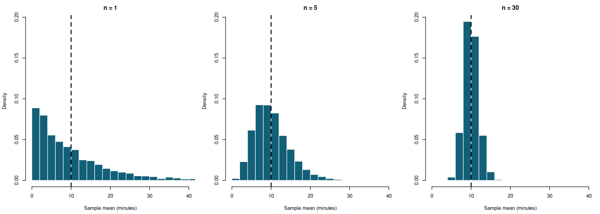

# ۱۲.۳ — میانگین به کجا می‌رود و شکلش چه می‌شود؟

## مسئلهٔ آغاز درس

با فایل ثابت سه ستون n1، n5 و n30 را کنار هم مقایسه می‌کنیم. هر ستون ۵۰۰ میانگین دارد.

هر سه مرکز نزدیک ۱۰ دارند. با بزرگ‌تر شدن n، مقیاس نوسان از ۱۰ به ۴٫۴۷ و حدود ۱٫۸۳ می‌رسد. قانون اعداد بزرگ دربارهٔ نزدیکیِ میانگین به ۱۰ است. قضیهٔ حد مرکزی دربارهٔ شکل آمارهٔ استانداردشده در نمونهٔ بزرگ است. خود انتظارهای فردی همان توزیع اولیه را دارند.

**پیش از اجرای نرم‌افزار.** در شکل n=۳۰، اگر محور افقی را تنگ‌تر بگیرید چه چیزی ممکن است گمراه‌کننده شود؟

حل تشریحی

خواننده پهناها را با فاصلهٔ دیداری مقایسه می‌کند. محور و بازهٔ مشترک بگذارید یا مقیاس متفاوت را آشکار بنویسید.

[Excel](../excel/L03.md) · [SPSS](../spss/L03.md) · [GraphPad Prism](../prism/L03.md) · [R](../r/L03.md) · [Python](../python/L03.md)

## مقدماتی

در مدل آموزشیِ انتظار نمایی با میانگین و SD برابر ۱۰ دقیقه، داده‌های فردی چوله‌اند. در شبیه‌سازی، هر میانگین از n نفر تازه ساخته می‌شود. نمودارها ۵۰۰۰ میانگین را برای هر اندازهٔ نمونه نشان می‌دهند.

## متوسط

**قانون اعداد بزرگ** می‌گوید تحت شرایط مناسب، با افزایش n میانگین نمونه به میانگین جمعیت نزدیک می‌شود. **قضیهٔ حد مرکزی** دربارهٔ شکل نوسان پیرامون آن میانگین است. برای نمونهٔ مستقل و هم‌توزیع با واریانس مثبت و متناهی، `(mean − μ)/(σ/sqrt(n))` در حد به نرمال استاندارد میل می‌کند.

## پیشرفته

در شبیه‌سازی این درس، اندازهٔ ۳۰ یک انتخاب برای مقایسه است. برای توزیع‌های به‌شدت چوله یا دارای دنبالهٔ سنگین، تقریب نرمال ممکن است در این اندازه ضعیف باشد. تعداد تکرارهای شبیه‌سازی را برای کم‌کردن نوسان نمودار بیشتر می‌کنیم. افزایش اندازهٔ هر نمونه بر خود توزیع نمونه‌گیری اثر دارد. اگر واریانس متناهی نباشد، صورت کلاسیک قضیه را به کار نمی‌بریم.

[درس پیش](L2-standard-error.md) · [تمرین‌ها](../exercises/README.md)

## نمونهٔ حل‌شده

**تقریب احتمال میانگین.** با μ=۱۰، σ=۱۰ و n=۱۰۰، SE=۱ است. آستانهٔ ۱۲ دقیقه در مقیاس میانگین z=۲ دارد. تقریب نرمال دنبالهٔ راست حدود ۰٫۰۲۲۸ است. این احتمال برای میانگین ۱۰۰ انتظار است.

[۳۰ تمرین سطح‌بندی‌شده و حل‌ها](../exercises/L3.md)

## کار با نرم‌افزار

ابتدا [کارگاه عملی این ماژول](../software-workshop.md) را باز کنید تا فایل و محیط را آماده کنید. سپس خروجی نمونه را با این بخش بسنجید.

**خروجی برای مقایسه.** شبیه‌سازی برای n برابر ۱، ۵ و ۳۰ به‌ترتیب SE نزدیک ۱۰، ۴٫۴۷ و ۱٫۸۳ می‌دهد.

Excel

سه ستون میانگین از اندازه‌های ۱، ۵ و ۳۰ بسازید. STDEV.S هر ستون را حساب کنید. نمودارها را با بازه‌های همسان کنار هم قرار دهید.

SPSS

جدول آمادهٔ n و میانگین نمونه را وارد کنید. در Explore، n را Factor و میانگین را Dependent قرار دهید و هیستوگرام‌ها و SD را بخوانید.

GraphPad Prism

سه ستون میانگین‌های آماده را وارد کنید. Frequency distribution را برای سه ستون با بازه‌های یکسان اجرا کنید و انحراف معیار هر ستون را در Column statistics بخوانید.

R

`Rscript --vanilla r/M12_simulation.R` را از پوشهٔ ماژول اجرا کنید. ستون theoretical_se معیار مقایسه است.

Python

`for n in (1,5,30): print(rng.exponential(10,(5000,n)).mean(axis=1).std(ddof=1))` را با generator ساخته‌شده اجرا کنید.

## خواندن و دیدن

[فیلم‌ها و مراجع نوشتاری هر پنج نرم‌افزار](../references.md#software-media)

- OpenStax، بخش Using the Central Limit Theorem.
- [Khan Academy، قضیهٔ حد مرکزی](https://www.khanacademy.org/video?v=JNm3M9cqWyc) — متوسط. تفاوت توزیع جمعیت و توزیع میانگین را دنبال کنید.

