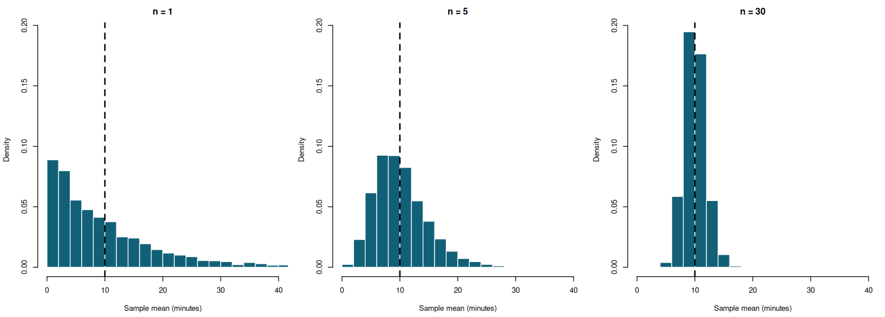

# M12 — از تکرار نمونه تا خطای استاندارد و حد مرکزی

جامعه‌ای آموزشی تنها مقدارهای ۰ و ۴ دارد و هر کدام احتمال برابر دارد. هر بار با جایگذاری انتخاب می‌کنیم. یک انتخاب ممکن است صفر یا چهار باشد. میانگین چند انتخاب شکل دیگری دارد. از همین جامعهٔ کوچک می‌توان توزیع دقیق میانگین را ساخت و تغییر آن را با اندازهٔ نمونه دید.

[توزیع حاصل از نمونه‌های تکراری](#section-1) · [انحراف معیار و خطای استاندارد](#section-2) · [قانون اعداد بزرگ و قضیهٔ حد مرکزی](#section-3) · [تمرین‌ها و نرم‌افزار](#practice)

## 1. توزیع حاصل از نمونه‌های تکراری

ابتدا همهٔ نمونه‌های ممکنِ بسیار کوچک را شمارش می‌کنیم.

### مسئلهٔ آغاز درس

از یک فرایند ساختگی دو گروه سه‌نفری گرفته‌ایم: ۴،۸،۱۲ و ۳،۹،۱۸ دقیقه.

میانگین نمونهٔ اول ۸ و نمونهٔ دوم ۱۰ است. برای نمایش زمان افراد شش عدد وارد نمودار می‌شود. برای نمایش توزیع میانگین، فقط دو عدد ۸ و ۱۰ وارد می‌شود. اگر این کار را ۵۰۰ بار تکرار کنیم، ۵۰۰ میانگین داریم. هر میانگین از نمونهٔ خودش ساخته شده است.

**پیش از اجرای نرم‌افزار.** با ۵۰۰ نمونهٔ پنج‌نفری، چند مقدار فردی و چند میانگین داریم؟

حل تشریحی

۲۵۰۰ مقدار فردی و ۵۰۰ میانگین. شکل میانگین‌ها از همان ستون ۵۰۰تایی ساخته می‌شود.

[Excel](../excel/L01.md) · [SPSS](../spss/L01.md) · [GraphPad Prism](../prism/L01.md) · [R](../r/L01.md) · [Python](../python/L01.md)

### مقدماتی

زمان انتظار ده مراجعه‌کننده را خلاصه می‌کنیم. اگر ده نفر تازه از همان جمعیت انتخاب کنیم، زمان انتظار میانگین عوض می‌شود. یک بار میانگین نمونه را دیده‌ایم و می‌خواهیم تغییر آن در تکرار نمونه‌گیری را بفهمیم.

### متوسط

**توزیع داده‌ها** زمان انتظار افراد را نشان می‌دهد. **توزیع نمونه‌گیری میانگین** میانگین‌های به‌دست‌آمده از نمونه‌های هم‌اندازه با روش یکسان را نشان می‌دهد. در رایانه می‌توان از یک مدل مشخص، هزاران نمونه گرفت و میانگین هر یک را ذخیره کرد.

### پیشرفته

پارامتر جمعیت، مانند μ، در این طرح ثابت است. میانگین نمونه با عوض‌شدن نمونه تغییر می‌کند. شکل توزیع نمونه‌گیری به جامعه، اندازهٔ نمونه، آماره و طرح نمونه‌گیری وابسته است. اگر داده‌ها خوشه‌ای‌اند، شبیه‌سازی‌ای که همهٔ افراد را مستقل می‌گیرد سازوکار نمونه‌گیری را بازسازی نمی‌کند.

### نمونهٔ حل‌شده

**ترکیب دو میانگین.** از نخستین نمونهٔ سه‌نفری، زمان‌های ۴، ۸، ۱۲ میانگین ۸ می‌دهند. از نمونهٔ دوم، ۳، ۹، ۱۸ میانگین ۱۰ می‌دهند. هیستوگرامِ میانگین دو ورودی ۸ و ۱۰ دارد.

[۳۰ تمرین سطح‌بندی‌شده و حل‌ها](../exercises/L1.md)

### کار با نرم‌افزار

ابتدا [کارگاه عملی این ماژول](../software-workshop.md) را باز کنید تا فایل و محیط را آماده کنید. سپس خروجی نمونه را با این بخش بسنجید.

**خروجی برای مقایسه.** برای ۵۰۰۰ تکرار، نمودار باید ۵۰۰۰ میانگین داشته باشد.

Excel

در هر سطر پنج مقدار `=-10*LN(1-RAND())` بسازید. میانگین سطر را در ستون ششم بگذارید. ستون ششم را رسم کنید.

SPSS

برای دادهٔ دارای شناسهٔ تکرار و زمان فردی، Data و Aggregate را باز کنید. شناسهٔ تکرار را Break Variable و میانگین زمان را متغیر خروجی بگذارید.

GraphPad Prism

نمونه‌های شبیه‌سازی‌شده را به صورت یک ستون برای هر تکرار وارد کنید یا میانگین‌های آماده را در یک ستون رسم کنید. تعداد میانگین‌های ورودی را بررسی کنید.

R

`set.seed(12); x <- replicate(5000, mean(rexp(5,.1))); hist(x)`.

Python

`rng = np.random.default_rng(12); x = rng.exponential(10, (5000,5)).mean(axis=1)` و سپس `plt.hist(x)`.

### خواندن و دیدن

[فیلم‌ها و مراجع نوشتاری هر پنج نرم‌افزار](../references.md#software-media)

- OpenStax، مقدمهٔ فصل The Central Limit Theorem.
- [Khan Academy، توزیع نمونه‌گیری میانگین](https://www.khanacademy.org/math/statistics-probability/statistics-inferential-statistics/sampling-distribution/v/sampling-distribution-of-the-sample-mean) — مقدماتی. تفاوت دادهٔ فردی و میانگین نمونه را پیدا کنید.

## 2. انحراف معیار و خطای استاندارد

حالا نوسان میانگین را از نوسان تک‌مقدار جدا می‌کنیم.

### مسئلهٔ آغاز درس

یک مدل انتظار با میانگین و SD برابر ۱۰ دقیقه داریم. اگر n=25 باشد، میانگین یک نمونه از نمونهٔ بعدی چقدر نوسان دارد؟

خطای استاندارد ۱۰/√۲۵=۲ دقیقه است. عدد ۱۰ هنوز SD افراد است. اگر ۱۰۰ فرد مستقل بگیریم، SE به ۱ دقیقه می‌رسد. برای کنترل شبیه‌سازی، SD ستون میانگین‌های تکراری را بگیرید. اگر میانگین هر سطر از پنج نفر ساخته شد، عدد مرجع ۱۰/√۵≈۴٫۴۷ است.

**پیش از اجرای نرم‌افزار.** اگر فقط تعداد تکرارها را زیاد کنیم و n هر نمونه تغییر نکند، کدام پراکندگی عوض می‌شود؟

حل تشریحی

SE نظری ثابت است. شکل تجربی و برآورد SE معمولاً پایدارتر می‌شوند. تعداد تکرار مدل نمایش را دقیق‌تر می‌کند و n اندازهٔ نمونه توزیع میانگین را تغییر می‌دهد.

[Excel](../excel/L02.md) · [SPSS](../spss/L02.md) · [GraphPad Prism](../prism/L02.md) · [R](../r/L02.md) · [Python](../python/L02.md)

### مقدماتی

انحراف معیار می‌گوید اندازه‌گیری افراد چقدر پراکنده است. خطای استاندارد یا SE، انحراف معیار توزیع نمونه‌گیری یک آماره است. اینجا آماره، میانگین نمونه است.

### متوسط

برای n اندازه‌گیری مستقل با توزیع یکسان و انحراف معیار جمعیت σ، خطای استاندارد میانگین `σ / sqrt(n)` است. اگر σ=۱۰ دقیقه باشد، SE برای n=۲۵ برابر ۲ دقیقه و برای n=۱۰۰ برابر ۱ دقیقه است. برای نصف کردن SE، در این طرح حجم نمونه را چهار برابر می‌کنیم.

### پیشرفته

اگر σ معلوم نیست، در همین طرح `s / sqrt(n)` برآورد SE است. واحد آن همان واحد داده است. وابستگی اندازه‌گیری‌ها، وزن نمونه‌گیری یا برداشت سهم بزرگی از جمعیت محدود می‌تواند فرمول را تغییر دهد. شمار اندازه‌گیری‌ها را با شمار واحدهای مستقل یکی فرض نکنید.

### نمونهٔ حل‌شده

**اندازهٔ نمونه از دقت مورد انتظار.** اگر SD جامعه ۱۲ و SE هدف حداکثر ۱٫۵ باشد، حجم نمونه باید دست‌کم (۱۲/۱٫۵)² = ۶۴ نفر مستقل باشد. این عدد مقدار هدف برای میانگین است.

[۳۰ تمرین سطح‌بندی‌شده و حل‌ها](../exercises/L2.md)

### کار با نرم‌افزار

ابتدا [کارگاه عملی این ماژول](../software-workshop.md) را باز کنید تا فایل و محیط را آماده کنید. سپس خروجی نمونه را با این بخش بسنجید.

**خروجی برای مقایسه.** با SD ده و n=25، SE برابر ۲ است.

Excel

`=10/SQRT(25)` و سپس `=10/SQRT(100)`. برای دادهٔ فردی از STDEV.S استفاده کنید.

SPSS

در Compute Variable از `10/SQRT(25)` کمک بگیرید. برای دادهٔ فردی، در خروجی Descriptives یا Explore مقدار Standard Error میانگین را بخوانید.

GraphPad Prism

۲۵ دادهٔ فردی را در Column بگذارید. در Column statistics، SD و SEM را بخوانید. با `SD/√25` بررسی کنید.

R

`10/sqrt(25)`. برای نمونهٔ x با مقادیر کامل، `sd(x)/sqrt(length(x))`.

Python

`10 / np.sqrt(25)`. برای نمونهٔ کامل، `x.std(ddof=1) / np.sqrt(x.size)`.

### خواندن و دیدن

[فیلم‌ها و مراجع نوشتاری هر پنج نرم‌افزار](../references.md#software-media)

- OpenStax، بخش Using the Central Limit Theorem.
- [Khan Academy، خطای استاندارد میانگین](https://www.khanacademy.org/v/standard-error-of-the-mean) — متوسط. پیش‌نیاز انحراف معیار است. تغییر SE با n را ببینید.

## 3. قانون اعداد بزرگ و قضیهٔ حد مرکزی

رفتار یک میانگین با بزرگ‌تر شدن n را با شکل توزیع میانگین‌ها اشتباه نکنید.

### مسئلهٔ آغاز درس

با فایل ثابت سه ستون n1، n5 و n30 را کنار هم مقایسه می‌کنیم. هر ستون ۵۰۰ میانگین دارد.

هر سه مرکز نزدیک ۱۰ دارند. با بزرگ‌تر شدن n، مقیاس نوسان از ۱۰ به ۴٫۴۷ و حدود ۱٫۸۳ می‌رسد. قانون اعداد بزرگ دربارهٔ نزدیکیِ میانگین به ۱۰ است. قضیهٔ حد مرکزی دربارهٔ شکل آمارهٔ استانداردشده در نمونهٔ بزرگ است. خود انتظارهای فردی همان توزیع اولیه را دارند.

**پیش از اجرای نرم‌افزار.** در شکل n=۳۰، اگر محور افقی را تنگ‌تر بگیرید چه چیزی ممکن است گمراه‌کننده شود؟

حل تشریحی

خواننده پهناها را با فاصلهٔ دیداری مقایسه می‌کند. محور و بازهٔ مشترک بگذارید یا مقیاس متفاوت را آشکار بنویسید.

[Excel](../excel/L03.md) · [SPSS](../spss/L03.md) · [GraphPad Prism](../prism/L03.md) · [R](../r/L03.md) · [Python](../python/L03.md)

### مقدماتی

در مدل آموزشیِ انتظار نمایی با میانگین و SD برابر ۱۰ دقیقه، داده‌های فردی چوله‌اند. در شبیه‌سازی، هر میانگین از n نفر تازه ساخته می‌شود. نمودارها ۵۰۰۰ میانگین را برای هر اندازهٔ نمونه نشان می‌دهند.

### متوسط

**قانون اعداد بزرگ** می‌گوید تحت شرایط مناسب، با افزایش n میانگین نمونه به میانگین جمعیت نزدیک می‌شود. **قضیهٔ حد مرکزی** دربارهٔ شکل نوسان پیرامون آن میانگین است. برای نمونهٔ مستقل و هم‌توزیع با واریانس مثبت و متناهی، `(mean − μ)/(σ/sqrt(n))` در حد به نرمال استاندارد میل می‌کند.

### پیشرفته

در شبیه‌سازی این درس، اندازهٔ ۳۰ یک انتخاب برای مقایسه است. برای توزیع‌های به‌شدت چوله یا دارای دنبالهٔ سنگین، تقریب نرمال ممکن است در این اندازه ضعیف باشد. تعداد تکرارهای شبیه‌سازی را برای کم‌کردن نوسان نمودار بیشتر می‌کنیم. افزایش اندازهٔ هر نمونه بر خود توزیع نمونه‌گیری اثر دارد. اگر واریانس متناهی نباشد، صورت کلاسیک قضیه را به کار نمی‌بریم.

### نمونهٔ حل‌شده

**تقریب احتمال میانگین.** با μ=۱۰، σ=۱۰ و n=۱۰۰، SE=۱ است. آستانهٔ ۱۲ دقیقه در مقیاس میانگین z=۲ دارد. تقریب نرمال دنبالهٔ راست حدود ۰٫۰۲۲۸ است. این احتمال برای میانگین ۱۰۰ انتظار است.

[۳۰ تمرین سطح‌بندی‌شده و حل‌ها](../exercises/L3.md)

### کار با نرم‌افزار

ابتدا [کارگاه عملی این ماژول](../software-workshop.md) را باز کنید تا فایل و محیط را آماده کنید. سپس خروجی نمونه را با این بخش بسنجید.

**خروجی برای مقایسه.** شبیه‌سازی برای n برابر ۱، ۵ و ۳۰ به‌ترتیب SE نزدیک ۱۰، ۴٫۴۷ و ۱٫۸۳ می‌دهد.

Excel

سه ستون میانگین از اندازه‌های ۱، ۵ و ۳۰ بسازید. STDEV.S هر ستون را حساب کنید. نمودارها را با بازه‌های همسان کنار هم قرار دهید.

SPSS

جدول آمادهٔ n و میانگین نمونه را وارد کنید. در Explore، n را Factor و میانگین را Dependent قرار دهید و هیستوگرام‌ها و SD را بخوانید.

GraphPad Prism

سه ستون میانگین‌های آماده را وارد کنید. Frequency distribution را برای سه ستون با بازه‌های یکسان اجرا کنید و انحراف معیار هر ستون را در Column statistics بخوانید.

R

`Rscript --vanilla r/M12_simulation.R` را از پوشهٔ ماژول اجرا کنید. ستون theoretical_se معیار مقایسه است.

Python

`for n in (1,5,30): print(rng.exponential(10,(5000,n)).mean(axis=1).std(ddof=1))` را با generator ساخته‌شده اجرا کنید.

### خواندن و دیدن

[فیلم‌ها و مراجع نوشتاری هر پنج نرم‌افزار](../references.md#software-media)

- OpenStax، بخش Using the Central Limit Theorem.
- [Khan Academy، قضیهٔ حد مرکزی](https://www.khanacademy.org/video?v=JNm3M9cqWyc) — متوسط. تفاوت توزیع جمعیت و توزیع میانگین را دنبال کنید.

## ۳۰ تمرین و مسئله و پنج مسیر نرم‌افزاری

[تمرین‌ها](../exercises/module.md) · [پاسخ تشریحی](../solutions/module.md)

[Excel](../excel/MODULE.md) · [SPSS](../spss/MODULE.md) · [GraphPad Prism](../prism/MODULE.md) · [R](../r/MODULE.md) · [Python](../python/MODULE.md)

[منابع نوشتاری و ویدیویی](../references.md) · [واژه‌نامه](../../../resources/glossary.md) · [گزارش وارسی](../VALIDATION.md)

