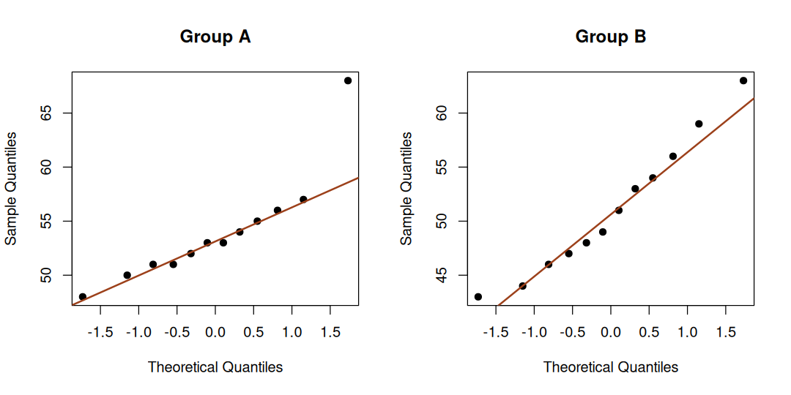

# M16 — وارسی داده و انتخاب آزمون بر اساس طراحی

پیش از پرسیدن «کدام آزمون؟»، سه چیز را ثبت کنید. پرسش ما دربارهٔ چیست، کدام مشاهده‌ها به هم وابسته‌اند، و آیا مقدار مشکوک از خطای ثبت آمده یا اندازه‌گیری معتبری است. با یک نمونهٔ جفتی و یک مقایسهٔ جداگانه این تصمیم‌ها را دنبال می‌کنیم.

[نمودار Q–Q و بررسی شکل](#section-1) · [واریانس گروه‌ها و گزینه‌های آزمون](#section-2) · [ردیف مشکوک و ثبت تصمیم](#section-3) · [انتخاب آزمون با توجه به طراحی](#section-4) · [تمرین‌ها و نرم‌افزار](#practice)

## 1. نمودار Q–Q و بررسی شکل

ابتدا نمودار را برای هماهنگی شکل و دنباله‌ها بخوانید.

در گروه A، آخرین سنجه ۶۸ و دیگر مقدارها بین ۴۸ و ۵۷ هستند. پیش از انتخاب مدل، بررسی می‌کنیم الگو به کیفیت ثبت یا به توزیع سنجه مربوط است.

### مقدماتی

اول تعیین کنید فرض نرمال دربارهٔ چیست. در t زوجی، اختلاف‌های زوجی را ببینید. در مدل رگرسیون، ساختار مانده‌ها مهم است. هیستوگرام و Q-Q را همراه دادهٔ خام بخوانید.

### متوسط

Shapiro–Wilk از داده‌های مرتب برای سنجش نرمال‌بودن بهره می‌گیرد. آزمون معمول Kolmogorov–Smirnov نیاز دارد توزیع مرجع و پارامترهای آن از پیش معلوم باشند. وقتی میانگین و SD از همین داده برآورد شده‌اند، برای نسخهٔ نرمال از کالیبراسیون Lilliefors کمک بگیرید.

### پیشرفته

Anderson–Darling به دنباله‌ها وزن بیشتری می‌دهد و کالیبراسیون آن به توزیع و نحوهٔ برآورد پارامتر وابسته است. D’Agostino–Pearson با چولگی و کشیدگی کار می‌کند و برای نمونهٔ خیلی کوچک مناسب نیست. P بزرگ نرمال‌بودن را ثابت نمی‌کند. با n بزرگ، انحراف کوچک هم می‌تواند آشکار شود.

### از پرسش تا تصمیم

در گروه A یکی از اعداد ۶۸ است و سایرها بین ۴۸ و ۵۷‌اند. افراد را روی محور نشان دهید و در Q-Q به انتهای بالا نگاه کنید. W حدود ۰٫۸۱۵ و P حدود ۰٫۰۱۴ است. این نتیجه همراه نمونهٔ کوچک و شکل داده تفسیر می‌شود. در طرح زوجی، نرمال‌بودن مربوط به اختلاف‌هاست.

**خودتان امتحان کنید.** اگر دو گروه مستقل داشته باشیم، چرا یک Q-Q از ترکیب دو گروه کافی نیست؟

حل تشریحی

ترکیب ممکن است حتی وقتی هر گروه شکل ساده‌ای دارد، به دلیل تفاوت مرکز دو گروه شکل دیگری پیدا کند. گروه‌ها را جدا ببینید.

### نمونهٔ حل‌شده

در A، Shapiro–Wilk مقدار W≈۰٫۸۱۵ و P≈۰٫۰۱۴ می‌دهد. در Q-Q مقدار ۶۸ را با پروندهٔ ساختگی و شیوهٔ تولید داده بسنجید. نتیجهٔ آزمون به‌تنهایی حکم حذف یا تغییر آزمون نمی‌دهد.

در گروه A نقطهٔ ۶۸ در سمت راست و بالای خط مرجع دیده می‌شود.

## 2. واریانس گروه‌ها و گزینه‌های آزمون

پس از نگاه به شکل، پراکندگی را در گروه‌ها جدا بررسی کنید.

برای دو گروه مستقل، تفاوت پراکندگی می‌تواند روی خطای استاندارد اختلاف میانگین اثر بگذارد.

### مقدماتی

SD هر گروه را با n و نمودار آن گروه گزارش کنید. برابری SD جمعیت را نمی‌توان از دو SD نمونه به‌تنهایی نتیجه گرفت.

### متوسط

Levene فاصلهٔ مطلق داده‌ها تا مرکز گروه را می‌گیرد و میانگین این فاصله‌ها را با ANOVA مقایسه می‌کند. مرکز میانگین در Levene کلاسیک و میانه در نسخهٔ Brown–Forsythe به کار می‌رود. نسخهٔ میانه در برابر بعضی انحراف‌ها از نرمال مقاوم‌تر است.

### پیشرفته

Bartlett برای چند واریانس و F برای نسبت دو واریانس تحت نرمال‌بودن حساس‌اند. برای F، ترتیب نسبت با df صورت و مخرج باید یکی باشد. به جای انتخاب خودکار بین t کلاسیک و Welch پس از یک آزمون برابری، روش را طبق طرح و سؤال از پیش مشخص کنید.

### از پرسش تا تصمیم

ابتدا برای هر مقدار فاصلهٔ مطلق تا میانهٔ گروه را بسازید. در Brown–Forsythe، یک ANOVA بر این فاصله‌ها اجرا می‌شود. برای دادهٔ تمرین F≈1.285 و P≈0.269 است. این نتیجه پراکندگی را می‌سنجد و آزمون اختلاف میانگین خام نیست.

**خودتان امتحان کنید.** اگر P بزرگ شد، آیا می‌توان برابری واریانس را قطعی دانست؟

حل تشریحی

خیر. داده برای یافتن تفاوت کافی نبوده است. اندازهٔ نمونه، SDها و مفروضات روش را هم بررسی کنید.

### نمونهٔ حل‌شده

در دو ستون A و B، Brown–Forsythe مقدار F≈۱٫۲۸۵ و P≈۰٫۲۶۹ می‌دهد. Bartlett مقدار χ²≈۰٫۳۵۳ و P≈۰٫۵۵۳ می‌دهد. این اعداد اثبات برابری واریانس‌ها نیستند.

## 3. ردیف مشکوک و ثبت تصمیم

یک نقطهٔ دور به راستی می‌تواند نتیجه را عوض کند. علت تغییر را مستند کنید.

مقدار ۶۸ ممکن است خوانش درست یک فرد، اشتباه ورود داده یا رخدادی خارج از سازوکار پژوهش باشد. این سه حالت یک تصمیم ندارند.

### مقدماتی

شناسه، مقیاس، روش ثبت و محدودهٔ ابزار را بررسی کنید. دلیل هر تغییر را ثبت کنید. اگر داده معتبر است، نتیجهٔ تحلیل اصلی و تحلیل حساسیت را کنار هم بخوانید.

### متوسط

Grubbs برای یک مقدار دورافتادهٔ بالقوه در دادهٔ تقریباً نرمال و مستقل ساخته شده است. `G=max|x−mean|/s` و آستانهٔ دوطرفه `(n−1)/√n × √(t²/(n−2+t²))` است که t صدک ۱−α/(۲n) با n−2 درجهٔ آزادی است. آزمون را پس از حذف پی‌درپی و بدون روش کنترل خطا تکرار نکنید.

### پیشرفته

در Prism، روش ROUT ابتدا با روش مقاوم برازش می‌دهد و سپس یافته‌های پرت را با هدف محدود کردن نرخ کشف کاذب شناسایی می‌کند. Q را از پیش تعیین و داده، روش، آستانه و اثر حذف بر نتیجه را گزارش کنید. Grubbs و ROUT فرض و هدف یکسان ندارند.

### از پرسش تا تصمیم

برای ۶۸، فاصلهٔ مطلق از میانگین گروه را بر SD همان گروه تقسیم کنید. G≈2.746 است. برای n=12 و α=.05، آستانه≈2.412 می‌شود. نتیجه فرد را برای بررسی علامت می‌زند. حالا شناسه، واحد و منبع ثبت را بخوانید.

**خودتان امتحان کنید.** اگر فایلی سه مقدار دور داشته باشد، می‌توان Grubbs را پی‌درپی اجرا و هر بار حذف کرد؟

حل تشریحی

اجرای پی‌درپی بدون طرحِ کنترل خطا اعتبار آزمون را تغییر می‌دهد. ابتدا منبع، مدل و روشی برای چند مقدار دور را بررسی کنید.

### نمونهٔ حل‌شده

در A، G≈۲٫۷۴۶ و آستانهٔ ۵٪ حدود ۲٫۴۱۲ است. بنابراین ۶۸ برای بررسی علامت می‌خورد. چون شکل داده و پیش‌فرض‌ها هم اهمیت دارند، خروجی نرم‌افزار به‌تنهایی تصمیم دربارهٔ حذف نیست.

## 4. انتخاب آزمون با توجه به طراحی

در پایان طرح و پرسش را کنار ویژگی داده قرار دهید.

پرسش، نوع پیامد و وابستگی داده را مشخص می‌کنند. سپس آزمون انتخاب می‌شود.

### مقدماتی

ابتدا بپرسید پیامد عددی، دوحالتی یا زمان‌تا‌رویداد است. سپس تعداد گروه‌ها و استقلال، جفت‌بودن یا خوشه‌بندی را ثبت کنید.

### متوسط

برای مقایسهٔ میانگین دو گروه مستقل، Welch گزینهٔ آغاز است، اگر رفتار میانگین و طرح آن را پشتیبانی کنند. برای دو نوبت همان افراد، t زوجی روی اختلاف‌هاست. برای پیامد دوحالتی مستقل، از جدول دو در دو و روش مناسب شمارها، مانند Fisher در نمونهٔ کوچک، کمک بگیرید. دادهٔ دوحالتی زوجی مک‌نمار می‌خواهد.

### پیشرفته

برای بیش از دو گروه یا دادهٔ تکراری، ساختار مدل، وابستگی و مقایسه‌های برنامه‌ریزی‌شده را مشخص کنید. آزمون رتبه‌ای مانند Mann–Whitney معمولاً یک فرض دربارهٔ توزیع‌ها یا رتبه‌ها را می‌سنجد. تعبیر آن به اختلاف میانه‌ها شرط اضافی دارد. برای خوشه‌ای یا بقا، روش مناسب همان طرح را در فاز مربوط دنبال کنید.

### از پرسش تا تصمیم

در فایل A و B، هر نفر فقط در یک گروه است و پیامد عددی است. اگر سؤال تفاوت میانگین است، آزمون Welch را می‌توان با فرض‌های طرح اجرا کرد. عدد مرجع t≈1.268 و P≈0.219 است. برای همان فرد در دو نوبت، اختلاف فردی و طرح زوجی لازم می‌شود.

**خودتان امتحان کنید.** اگر به جای عدد، پاسخ هر فرد بله یا خیر بود، آیا Welch همان انتخاب می‌ماند؟

حل تشریحی

ابتدا هدف را به نسبت یا تفاوت نسبت تبدیل کنید و طرح مستقل یا زوجی را مشخص کنید. جدول دو در دو مستقل و دادهٔ بله/خیر زوجی روش یکسانی ندارند.

### نمونهٔ حل‌شده

A و B این تمرین دو گروه مستقل با پیامد عددی هستند. برای نمایش محاسبهٔ Welch، t≈۱٫۲۶۸ و P≈۰٫۲۱۹ می‌گیریم. همراه این خروجی، اثر مقدار ۶۸ بر میانگین و شکل نمونه را در تحلیل حساسیت بررسی می‌کنیم.

## ۳۰ تمرین و مسئله و پنج مسیر نرم‌افزاری

[تمرین‌ها](../exercises/module.md) · [پاسخ تشریحی](../solutions/module.md)

[Excel](../excel/MODULE.md) · [SPSS](../spss/MODULE.md) · [GraphPad Prism](../prism/MODULE.md) · [R](../r/MODULE.md) · [Python](../python/MODULE.md)

[منابع نوشتاری و ویدیویی](../references.md) · [واژه‌نامه](../../../resources/glossary.md) · [گزارش وارسی](../VALIDATION.md)

