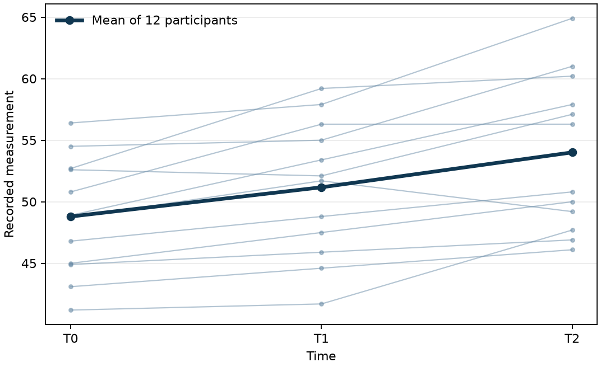

# M22 — تحلیل واریانس یک‌طرفه با اندازه‌گیری‌های تکراری

در یک پیگیری آموزشی، پژوهشگر برای ۱۲ فرد یک سنجهٔ کمّی را در آغاز، میانه و پایان ثبت کرده است. آیا میانگین سنجه در سه نوبت یکسان است؟ اگر میانگین تغییر کرده، پژوهشگر از آغاز تا پایان چه اندازه تغییر دیده است؟ پرسش اول با آزمون کلی زمان و پرسش دوم با مقایسهٔ زوجی پاسخ داده می‌شود.

[خواندن داده و آزمون کلی](#section-1) · [کرویت](#section-2) · [مقایسهٔ زوجی](#section-3) · [تمرین‌ها و نرم‌افزار](#practice)

## یک فرد و سه اندازه‌گیری

[مجموعه‌دادهٔ پهن](../data/wide.csv) را باز کنید. ستون id شناسهٔ فرد، group کد گروه و t0c0، t1c0 و t2c0 مقدارهای سه زمان در شرط صفر هستند. در این ماژول همین سه ستون را می‌خوانیم. [دادهٔ بلند](../data/practice.csv) همهٔ شرط‌ها را دارد. برای مقایسهٔ همان داده در قالب بلند، فقط ردیف‌هایی را نگه دارید که condition=0 دارند. در قالب پهن هر فرد یک ردیف و در قالب بلندِ شرط صفر هر فرد سه ردیف دارد.

| شناسه | زمان ۰ | زمان ۱ | زمان ۲ | تغییر زمان ۲ منهای ۰ |
|---|---:|---:|---:|---:|
| ۱ | ۴۱٫۲ | ۴۱٫۷ | ۴۷٫۷ | ۶٫۵ |
| ۲ | ۴۴٫۹ | ۴۵٫۹ | ۴۶٫۹ | ۲ |
| ۳ | ۴۳٫۱ | ۴۴٫۶ | ۴۶٫۱ | ۳ |

زمان ۲ برای شناسهٔ ۱ را از همان ردیف بردارید و از آن ۴۱٫۲ کم کنید تا ۶٫۵ به دست آید. اگر تنها ستون زمان ۲ جابه‌جا شود، میانگین زمان ۲ ثابت می‌ماند، ولی مقدارهای تفاضل فردی عوض می‌شوند. در این مثال، دادهٔ هر سه نوبت برای ۱۲ نفر کامل است. در دادهٔ واقعی پیش از محاسبه شمار ترکیب‌های id و time را بررسی کنید. فیلد خالی را گمشده نگه دارید. اگر بیش از یک ردیف به یک شناسه و زمان تعلق دارد، منشأ ثبت تکراری و روش تجمیع را بررسی کنید. برای طرح ناقص می‌توان مدل آمیخته‌ای را بررسی کرد که علت گمشدگی و ساختار وابستگی را روشن کند.

هر خط روشن سه اندازهٔ یک فرد را به هم وصل می‌کند. خط پررنگ میانگین سه زمان است. برخی خط‌های فردی در بخشی از پیگیری نزولی‌اند. میانگین گروه مسیر تک‌تک افراد را نشان نمی‌دهد.

## آزمون کلی زمان

فرض صفر می‌گوید میانگین جامعه در هر سه نوبت یکسان است. میانگین‌های نمونه ۴۸٫۸۰۰، ۵۱٫۱۷۵ و ۵۴٫۰۰۸ هستند. در محاسبه، نخست تفاوت پایدار سطح سنجه میان افراد را در نظر می‌گیریم. برای فرد اول میانگین سه نوبت تقریباً ۴۳٫۵۳ است. میانگین کل ۳۶ اندازه‌گیری تقریباً ۵۱٫۳۳ است. اگر اثر زمان ۰ را با فاصلهٔ میانگین زمان ۰ از میانگین کل بسازیم، ماندهٔ مشاهدهٔ نخست از رابطهٔ زیر به دست می‌آید.

> مانده = مشاهده − میانگین فرد − میانگین زمان + میانگین کل

پس از ساخت مانده‌ها، مربع آن‌ها را جمع کنید. در دادهٔ اصلی، جمع مربعات زمان ۱۶۳٫۱۸، جمع مربعات خطای زمان ۷۱٫۴۹ و جمع مربعات میان افراد ۹۵۱٫۰۷ است. تفاوت سطح ۱۲ فرد، ۱۱ درجهٔ آزادی دارد. زمان سه سطح و ۲ درجهٔ آزادی دارد. ۲۲ درجهٔ آزادی برای خطای زمان باقی می‌ماند. میانگین مربعات زمان ۱۶۳٫۱۸÷۲ و میانگین مربعات خطای زمان ۷۱٫۴۹÷۲۲ است. نسبت آن‌ها F≈۲۵٫۱۱ می‌شود. در مدل کلاسیک و با فرض کرویت، P≈۰٫۰۰۰۰۰۲۱۰ است.

اگر تنها میانگین‌های سه نوبت را دارید، میانگین تغییر را می‌توانید بیابید. برای بازتولید خطای آزمون، لازم است مقادیر همان فرد در سه نوبت یا خلاصه‌ای از پراکندگی مشترک آن‌ها را نیز داشته باشید.

## سه اختلاف و فرض کرویت

برای هر فرد سه تفاضل بسازید. برای شناسهٔ ۱، T1−T0=۰٫۵، T2−T0=۶٫۵ و T2−T1=۶ است. کرویت یعنی پراکندگی این سه نوع تفاضل در جامعه یکسان باشد. آن را با برابری پراکندگی سنجه در هر نوبت اشتباه نگیرید. برای دو زمان فقط یک تفاضل وجود دارد و مقایسهٔ چند واریانس مطرح نیست.

برای محاسبهٔ گرین‌هاوس–گایزر، از دو جهت مستقل خطی برای ساختن تمام اختلاف‌های زمانی کمک می‌گیریم. برای هر نفر U=(T0−T1)/√۲ و V=(T0+T1−۲T2)/√۶ را بسازید. از ۱۲ جفت، واریانس‌های U و V و کوواریانس‌شان را حساب کنید. کوواریانس نشان می‌دهد دو متغیر حول میانگین‌هایشان چگونه با یکدیگر تغییر می‌کنند.

اگر واریانس‌ها a و b و کوواریانس s باشد، ضریب از رابطهٔ ε=(a+b)²/[۲×(a²+b²+۲s²)] به دست می‌آید. در این طرح سه‌زمانه ε بین ۰٫۵ و ۱ است. برای دادهٔ کارگاه ε≈۰٫۹۰۴۶ است. هر دو درجهٔ آزادی را در ε ضرب کنید. صورت تقریباً ۱٫۸۰۹، مخرج تقریباً ۱۹٫۹۰۰ و P≈۰٫۰۰۰۰۰۵۶۶ می‌شود. F همان ۲۵٫۱۱ است. اگر برنامهٔ تحلیل از پیش این روش را تعیین کرده، ε، دو درجهٔ آزادی بازبینی‌شده و P را با هم بنویسید. آزمون Mauchly شواهد دربارهٔ کرویت را می‌سنجد. به‌ویژه در نمونهٔ کوچک، P بزرگ این آزمون به‌تنهایی کرویت را ثابت نمی‌کند.

## اندازهٔ تغییر و گزارش

برای پرسش «از زمان صفر تا زمان دو چه اندازه تغییر رخ داده؟» دوازده اختلاف T2−T0 را بسازید. میانگین آن‌ها ۵٫۲۰۸ واحد است. فاصلهٔ اطمینان تکی ۹۵٪ از ۳٫۵۶۹ تا ۶٫۸۴۸ واحد و P خام آزمون t زوجی تقریباً ۰٫۰۰۰۰۲۲۹ است. این جهت و فاصله از اختلاف‌های فردی به دست آمده‌اند.

اگر هر سه جفت بخشی از یک خانواده‌اند، Pهای خام را به ترتیب کوچک به بزرگ مرتب کنید. در تعدیل Holm، کوچک‌ترین P در ۳، بعدی در ۲ و آخرین P در ۱ ضرب می‌شود. هر مقدار تعدیل‌شده باید دست‌کم برابر مقدار قبلی باشد و از ۱ بیشتر نشود. پس از محاسبه، نام اصلی هر مقایسه را به آن برگردانید.

| مقایسه | P خام | P تعدیل‌شدهٔ Holm |
|---|---:|---:|
| T1−T0 | ۰٫۰۰۲۷۵۹ | ۰٫۰۰۵۵۱۸ |
| T2−T0 | ۰٫۰۰۰۰۲۲۹۱۴ | ۰٫۰۰۰۰۶۸۷۴۲ |
| T2−T1 | ۰٫۰۰۵۷۳۶ | ۰٫۰۰۵۷۳۶ |

**نمونهٔ گزارش.** «در ۱۲ فرد دارای هر سه نوبت، اثر زمان در شرط صفر با بازبینی گرین‌هاوس–گایزر F(۱٫۸۱،۱۹٫۹۰)=۲۵٫۱۱ و P≈۰٫۰۰۰۰۰۵۶۶ بود. برآورد تغییر از آغاز تا پایان ۵٫۲۱ واحد و فاصلهٔ اطمینان تکی ۹۵٪ از ۳٫۵۷ تا ۶٫۸۵ بود.» اگر پرسش از ابتدا تنها همین یک جفت بوده، P همان آزمون تکی را گزارش کنید. اگر جفت از بین سه مقایسه برگزیده شده، P تعدیل‌شده را اضافه کنید. تفاوت در طول زمان به‌تنهایی برای نتیجه‌گیری علّی کافی نیست.

## تمرین و بازتولید

از دادهٔ پهن، برای سه نفر نخست جدول تغییر و سپس برای هر ۱۲ نفر آزمون کلی بسازید. یک روش نرم‌افزاری را کامل انجام دهید و P، درجات آزادی، نام جفت و جهت اثر را کنار هم یادداشت کنید.

[۳۰ تمرین و مسئله](../exercises/module.md) · [فهرست ۳۰ پاسخ تشریحی](../solutions/module.md)

[Excel](../excel/MODULE.md) · [SPSS](../spss/MODULE.md) · [GraphPad Prism](../prism/MODULE.md) · [R](../r/MODULE.md) · [Python](../python/MODULE.md)

برای خواندن بیشتر، راهنمای آمار GraphPad بخش Repeated measures one-way ANOVA را دنبال کنید. ابتدا بخش چیدمان داده برای جفت‌کردن اندازه‌ها و سپس بخش تفسیر epsilon را بخوانید. برای مسیر R، بخش Details از راهنمای aov توضیح می‌دهد Error چطور سطوح خطا را می‌سازد.

[منابع و فیلم‌ها](../references.md) · [واژه‌نامهٔ دوره](../../../resources/glossary.md) · [اعتبارسنجی](../VALIDATION.md)

[درس پیش](../../M21-two-way-factorial-anova/lessons/README.md) · [درس بعد](../../M23-two-way-rm-mixed-anova/lessons/README.md)

