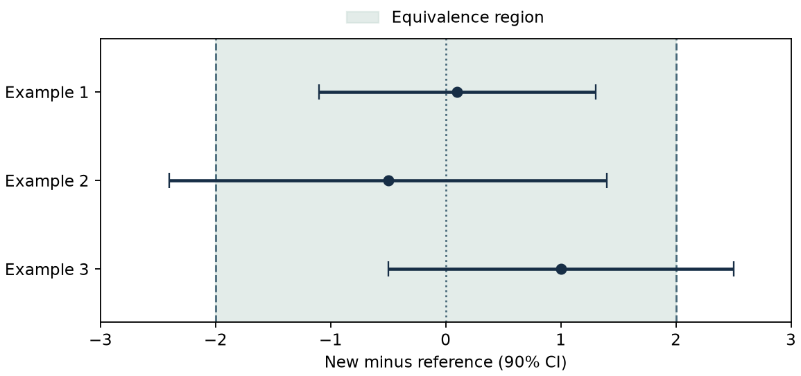

# M29 — هم‌ارزی و آزمون کم‌اثر نبودن

آزمایشگاه شیوهٔ تازه‌ای برای اندازه‌گیری یک سنجه دارد. می‌خواهد بداند اختلاف آن با روش مرجع از دید کاربردی کوچک است. برای طرح دیگری ممکن است تنها بخواهد مطمئن شود روش تازه بیش از اندازهٔ پذیرفتنی بدتر نیست. برای این دو سؤال، حدهای قابل قبول را پیش از دیدن داده تعریف می‌کنیم.

[حاشیه و جهت](#section-1) · [TOST برای میانگین](#section-2) · [تفاوت دو نسبت](#section-3) · [تمرین و نرم‌افزار](#practice)

## از سؤال کاربردی تا مرز آزمون

Δ را میانگین روش تازه منهای میانگین روش مرجع تعریف کنید. در سناریوی آموزشی، اختلاف کمتر از ۲ واحد در هر جهت قابل قبول است. حاشیه‌ها L=−۲ و U=+۲ هستند. برای هم‌ارزی، فرض صفر این است که Δ در یکی از دو بیرون بازه باشد، یعنی Δ≤L یا Δ≥U. برای نتیجهٔ هم‌ارزی، هر دو احتمال را کنار می‌زنیم. در مطالعهٔ واقعی، مقدار حاشیه از دقت مورد نیاز، اندازهٔ اثر مهم و شواهد موضوعی می‌آید. حاشیهٔ این تمرین آموزشی است.

اگر بزرگ‌تر بهتر باشد، در آزمون کم‌اثر نبودن تنها بررسی می‌کنیم که Δ از حد پایین L بزرگ‌تر است. برای سنجه‌ای که کوچک‌تر بهتر است، مانند زمان انتظار، با همان تعریف «تازه منهای مرجع» حد بالا اهمیت دارد. جهت اختلاف و مطلوب بودن افزایش یا کاهش را کنار حاشیه یادداشت کنید.

با سطح یک‌طرفهٔ ۰٫۰۵، فاصلهٔ دوطرفهٔ ۹۰٪ برای همان مدل را ببینید. هر دو کران باید به‌طور کامل داخل (L,U) باشند. در نمونهٔ اول شکل، بازهٔ [−۱٫۱،۱٫۳] داخل (−۲،۲) است. در نمونهٔ دوم، بازهٔ [−۲٫۴،۱٫۴] از حد پایین می‌گذرد. در نمونهٔ سوم، [−۰٫۵،۲٫۵] کران پایینِ بالاتر از −۲ دارد و برای شرط کم‌اثر نبودن در جهت «بزرگ‌تر بهتر» کافی است، در حالی که کران بالا بیرون حاشیهٔ هم‌ارزی است.

عبور نکردن از صفر در آزمون معمول تفاوت به سؤال دیگری مربوط می‌شود. بازه‌ای که صفر را دارد ممکن است باریک و درون حاشیه‌ها باشد یا پهن و بیرون آن‌ها. برای هم‌ارزی باید عرض بازه و فاصلهٔ دو کران از حدود را بررسی کنید. اگر سطح یک‌طرفهٔ ۰٫۰۲۵ از قبل انتخاب شده باشد، به جای ۹۰٪ از فاصلهٔ دوطرفهٔ ۹۵٪ همان مدل کمک بگیرید. هنگام گرد کردن کنترل کنید که کرانِ نزدیک به حد، جهت تصمیم را پنهان نکند.

## دو آزمون یک‌طرفه برای میانگین‌ها

[دادهٔ ساختگی دو گروه](../data/means.csv) ۲۰ مشاهدهٔ روش تازه و ۲۰ مشاهدهٔ روش مرجع دارد. در فایل، گروه ۱ روش تازه و گروه ۰ مرجع است. میانگین‌ها حدود ۵۰٫۴ و ۵۰٫۰ و انحراف استاندارد هر گروه حدود ۱٫۸۹۷ است. این گروه‌ها جدا هستند. برای کارگاه واریانس مشترک در نظر می‌گیریم. خطای استاندارد اختلاف از s تجمعی ضربدر √(۱/۲۰+۱/۲۰) ساخته می‌شود و حدود ۰٫۶ است. درجهٔ آزادی ۲۰+۲۰−۲=۳۸ است.

در آزمون‌های دو یک‌طرفه، که به TOST کوتاه می‌شود، هر مرز را یک بار بررسی می‌کنیم.

1. برای حد پایین، tL=(d−L)/SE. با d=۰٫۴، L=−۲ و SE=۰٫۶ داریم tL=۴. احتمال سمت راست توزیع t با ۳۸ درجهٔ آزادی حدود ۰٫۰۰۰۱۴۱ است.
2. برای حد بالا، tU=(d−U)/SE. با U=۲ داریم tU≈−۲٫۶۶۷. احتمال سمت چپ حدود ۰٫۰۰۵۵۹۶ است.
3. برای اعلان هم‌ارزی لازم است هر دو P کمتر از ۰٫۰۵ باشند. بزرگ‌ترِ دو P را می‌توان به عنوان P آزمون TOST نوشت. در این‌جا حدود ۰٫۰۰۵۵۹۶ است.

فاصلهٔ ۹۰٪ از d ± t₀٫₉₅×SE به دست می‌آید. در دادهٔ تمرین، کران‌ها −۰٫۶۱۲ و ۱٫۴۱۲ هستند و درون حاشیه‌ها می‌مانند. اگر با همان اختلاف و درجهٔ آزادی، SE از ۰٫۶ به ۱ برسد، عرض بازه بیشتر می‌شود و کران بالا از ۲ عبور می‌کند. برآورد مرکزی به تنهایی برای هم‌ارزی کافی نیست.

برای دادهٔ زوجی، نخست تفاضل هر زوج را بسازید و از میانگین، انحراف استاندارد و تعداد تفاضل‌ها کمک بگیرید. اگر گروه‌ها جدا باشند ولی واریانس مشترک مناسب نباشد، Welch خطای استاندارد و درجهٔ آزادی خودش را می‌دهد. قاعدهٔ دو مرز ثابت می‌ماند و آزمون و فاصله باید از یک روش واحد به دست آیند.

## تفاوت دو نسبت

در [دادهٔ دودویی ساختگی](../data/proportions.csv)، response برابر ۱ برای رخداد و صفر برای نبود رخداد است. از ۲۰۰ مورد در گروه تازه، ۹۰ رخداد و از ۲۰۰ مورد در گروه مرجع، ۸۴ رخداد داریم. نسبت‌ها ۰٫۴۵ و ۰٫۴۲ هستند. تفاوت تازه منهای مرجع ۰٫۰۳ یا ۳ واحد درصد است. مرز آموزشی ±۰٫۱۲ یعنی ±۱۲ واحد درصد است.

در تقریب Wald، برای هر گروه p(1−p)/n را حساب می‌کنیم. این‌جا خطای استاندارد برابر √[۰٫۴۵×۰٫۵۵÷۲۰۰ + ۰٫۴۲×۰٫۵۸÷۲۰۰]≈۰٫۰۴۹۵۵ است. با Z=(d−L)/SE برای پایین و Z=(d−U)/SE برای بالا و با همان انتخاب دنباله‌ها، Pها حدود ۰٫۰۰۱۲۳۵ و ۰٫۰۳۴۶۶۷ هستند. فاصلهٔ ۹۰٪ حدود [−۰٫۰۵۱۵۱،۰٫۱۱۱۵۱] است. کران‌ها در حاشیه‌ها قرار دارند.

این محاسبه یک تقریب آموزشی با گروه‌های جدا و شمارهای نسبتاً بزرگ است. دادهٔ اندک، رخداد بسیار کم یا نسبت نزدیک صفر یا یک می‌تواند تقریب را ضعیف کند. اگر روش دیگری مانند روش مبتنی بر امتیاز انتخاب شده، آزمون و فاصله را از همان روش گزارش کنید. اگر سنجهٔ اثر نسبت خطر است، حاشیه را روی مقیاس نسبت تعریف کنید و آن را با تفاوت درصدها جابه‌جا نکنید.

**نمونهٔ گزارش.** «برای تفاوت میانگین تازه منهای مرجع، حاشیهٔ آموزشی (−۲،۲) و سطح یک‌طرفهٔ ۰٫۰۵ از پیش تعیین شد. اختلاف ۰٫۴ و فاصلهٔ دوطرفهٔ ۹۰٪ از −۰٫۶۱۲ تا ۱٫۴۱۲ بود. در TOST با فرض واریانس مشترک، P بزرگ‌تر حدود ۰٫۰۰۵۶ بود و هر دو مرز رد شدند.» تفسیر را با تعریف سنجه، طرح، حاشیه و روش فاصله کامل کنید.

## تمرین و بازتولید

نخست سه بازهٔ شکل را بدون نرم‌افزار تفسیر کنید. بعد میانگین و تعداد گروه‌ها را از CSV بسازید و در یکی از پنج ابزار Pها، فاصله و جهت نتیجه را بنویسید.

[۳۰ تمرین و مسئله](../exercises/module.md) · [۳۰ پاسخ تشریحی](../solutions/module.md)

[Excel](../excel/MODULE.md) · [SPSS](../spss/MODULE.md) · [GraphPad Prism](../prism/MODULE.md) · [R](../r/MODULE.md) · [Python](../python/MODULE.md)

برای خواندن بیشتر، بخش Testing for equivalence with confidence intervals or P values از راهنمای GraphPad، رابطهٔ دو آزمون یک‌طرفه و فاصله را توضیح می‌دهد. مستندات statsmodels برای ttost_ind و ttost_paired تفاوت دادهٔ جدا و زوجی را نشان می‌دهد.

[منابع و فیلم‌ها](../references.md) · [واژه‌نامه](../../../resources/glossary.md) · [اعتبارسنجی](../VALIDATION.md)

[درس پیش](../../M28-experimental-designs/lessons/README.md) · [درس بعد](../../../phase-05-nonparametric/M30-sign-wilcoxon-runs/lessons/L1.md)

