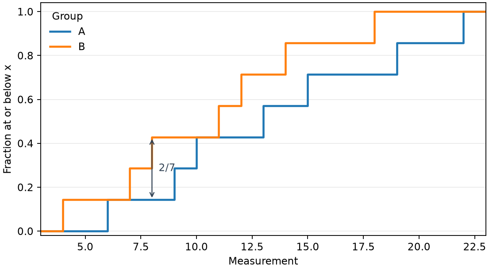

# M31 — مقایسهٔ ناپارامتری دو گروه جداگانه

دو گروه جدا از نمونه‌های آزمایشگاهی را با روش A و B اندازه گرفته‌ایم. یک پژوهشگر می‌پرسد آیا مقدارهای A گرایش دارند بزرگ‌تر باشند. پژوهشگر دیگری می‌خواهد بداند شکل توزیع دو گروه چقدر فرق دارد. سؤال سوم دربارهٔ سهم قرار گرفتن بالای میانهٔ ادغام‌شده است. با یک فایل، هر سه سؤال را جدا دنبال می‌کنیم.

[رتبه و U](#section-1) · [فاصلهٔ تجمعی D](#section-2) · [میانه و اندازهٔ اختلاف](#section-3) · [تمرین و نرم‌افزار](#practice)

[دادهٔ پایه](../data/practice.csv) هفت مشاهده از A و هفت از B دارد. group نام گروه و value مقدار اندازه‌گیری است. هر ردیف یک مشاهدهٔ جداست و ردیف‌های A و B با هم زوج نیستند. [دادهٔ افزوده](../data/extended.csv) برای تمرین با ۲۴ مشاهده در هر گروه و مقدارهای مساوی ساخته شده است.

## Mann–Whitney از ترتیب مقدارها کمک می‌گیرد

همهٔ ۱۴ مقدار را از کوچک به بزرگ مرتب کنید و رتبه‌های ۱ تا ۱۴ بدهید. کوچک‌ترین عدد ۴ و متعلق به B و پس از آن ۶ و متعلق به A است، پس ۶ رتبهٔ ۲ دارد. جمع رتبه‌های A برابر ۶۰ است. اگر هر هفت مقدار A پایین‌تر از همهٔ Bها بودند، جمع رتبه‌های A برابر ۱+۲+…+۷=۲۸ می‌شد. این مقدار پایه را کم کنید. به U_A=۶۰−۲۸=۳۲ می‌رسید.

همین U را می‌توان از ۷×۷=۴۹ مقایسهٔ A با B ساخت. هر بار A>B باشد یک امتیاز به A و اگر برابر باشند نیم امتیاز می‌رسد. به این ترتیب U_A/۴۹≈۰٫۶۵۳ است. این نسبت تخمینی از احتمال برتری A در یک جفت تصادفی به‌علاوهٔ نصف احتمال تساوی است. U_B=۴۹−۳۲=۱۷ است. برخی برنامه‌ها U گروه اول و برخی کوچک‌ترِ دو U را می‌دهند. برای جهت علمی از تعریف A−B و مقدارهای خود داده کمک بگیرید.

در فایل پایه مقدار مساوی نداریم. زیر فرض دو توزیع یکسان و جدا بودن مشاهده‌ها، می‌توان برچسب A را به هر ترکیب هفت‌تایی از ۱۴ رتبه داد. شمار کل C(۱۴،۷)=۳۴۳۲ است. P دوطرفهٔ دقیق این درس حدود ۰٫۳۸۲۸۶۷ است. این نتیجه به تنهایی برابری توزیع یا نبود اختلاف کاربردی را ثابت نمی‌کند. اگر هدف اختلاف مکان است، شباهت شکل و پراکندگی دو گروه برای تفسیر اهمیت دارد.

در دادهٔ افزوده مقدار مساوی داریم. رتبهٔ میانگین و نیم‌امتیاز را نگه دارید و روش P را مشخص کنید. برای تمرین، کد کارگاه در این داده از تقریب با تصحیح رتبه‌های مساوی و بدون اصلاح پیوستگی بهره می‌گیرد. توزیع دقیقِ بدون رتبهٔ مساوی فایل پایه را مستقیم به آن نسبت ندهید.

## کلموگروف–اسمیرنوف بزرگ‌ترین فاصلهٔ تجمعی را می‌سنجد

در هر آستانهٔ x، سهم مقدارهای ≤x را از هر گروه به دست آورید. این سهم را تابع توزیع تجربی می‌نامیم. در x=۸، در A تنها ۶ و در B مقدارهای ۴،۷،۸ در شمار تجمعی‌اند. سهم‌ها ۱/۷ و ۳/۷ و اختلاف مطلق ۲/۷ است. در x=۱۲، ۱۴ و ۱۸ هم فاصلهٔ ۲/۷ دیده می‌شود. پس از کنترل همهٔ آستانه‌ها می‌فهمیم D=۲/۷≈۰٫۲۸۵۷ بزرگ‌ترین فاصله است.

D می‌تواند از جابه‌جایی مکان، تفاوت گستره یا شکل توزیع به وجود آید. در فایل پایه P دقیق ≈۰٫۹۶۲۷۰۴ است. برای ساخت P دقیق، برچسب‌های گروه را روی ترتیب ثابت مقدارها جابه‌جا می‌کنیم. در کاربرگ می‌شماریم چند مسیرِ تجمعی در همهٔ گام‌ها فاصلهٔ کمتر از D دیده‌شده دارند. احتمال دنبالهٔ راست، یک منهای سهم همین مسیرهاست. شرط «کمتر» باعث می‌شود چیدمان‌های دارای فاصلهٔ برابر با D در احتمال آزمون بمانند.

اگر چند مشاهده مقدار یکسان داشته باشند، همه را در همان آستانه وارد شمار تجمعی کنید. بررسی فاصله در وسط یک دستهٔ هم‌ارزش، D را می‌تواند به‌طور ساختگی بزرگ کند. برای دادهٔ افزوده، کد کارگاه P را به‌صورت جایگشتیِ مشروط بر همان مقدارهای تجمیع‌شده می‌سازد. در این حالت برای هر دستهٔ هم‌ارزش، راه‌های تخصیص برچسب به اعضایش وزن می‌گیرند. جدول پایهٔ Excel برای ۱۴ مقدار بدون تساوی است.

## آزمون میانه و برآورد اختلاف

برای یک آزمون سادهٔ میانه، میانهٔ ادغام ۱۴ عدد را بگیرید. مقدارهای هفتم و هشتم ۱۱ و ۱۲ هستند و میانه ۱۱٫۵ است. برای هر گروه شمار بالاتر از ۱۱٫۵ را مقابل شمار کمتر یا برابر بگذارید.

| گروه | بالاتر از ۱۱٫۵ | برابر یا پایین‌تر |
|---|---:|---:|
| A | ۴ | ۳ |
| B | ۳ | ۴ |

در کارگاه، برای شمار کوچک از Fisher دقیق روی جدول ۲×۲ کمک می‌گیریم. P=۱ است. در برخی پیاده‌سازی‌های آزمون میانه، χ² تقریبی یا قاعدهٔ دیگری برای برخورد با مساوی‌های میانه به کار می‌رود. همان روش را در گزارش بنویسید. دوگانه کردن داده، اطلاعات فاصله و رتبهٔ مقدارها را کنار می‌گذارد.

برای اندازهٔ اختلاف می‌توانید برآورد Hodges–Lehmann را بسازید. تمام ۴۹ تفاضل A−B، از جمله ۶−۴=۲ و ۶−۷=−۱، را حساب کنید و میانه بگیرید. میانهٔ این شبکه در فایل پایه ۲ است. ترتیب A و B را عوض کنید تا نشانهٔ اثر عوض شود. اختلاف میانه‌های نمونه و میانهٔ تمام تفاضل‌ها در برخی داده‌ها یکسان‌اند و الزامی برای برابری آن‌ها وجود ندارد. برای تفسیر به صورت تغییر مکانی، شکل دو توزیع و دامنهٔ اختلاف‌ها را ببینید.

**نمونهٔ گزارش.** «در دو گروه هفت‌تایی، U گروه A برابر ۳۲ و P دقیق دوطرفه ۰٫۳۸۳ بود. برآورد Hodges–Lehmann برای A−B دو واحد بود. بزرگ‌ترین فاصلهٔ تجمعی ۰٫۲۸۶ و P دقیق KS حدود ۰٫۹۶۳ بود.» اگر آزمون‌های چندگانه برای یک سؤال انجام شده‌اند، هدف آزمون اصلی و روش برخورد با چندگانگی را روشن کنید.

## تمرین و بازتولید

ابتدا جمع رتبه‌ها، یک آستانهٔ ECDF و دو خانهٔ جدول میانه را با دست پیدا کنید. سپس در یکی از پنج نرم‌افزار، مقدارهای کنترل و روش دقیق یا تقریبی را بنویسید. در دادهٔ افزوده از یک مقدار مساوی برای کنترل تعریف رتبه کمک بگیرید.

[۳۰ تمرین و مسئله](../exercises/module.md) · [۳۰ پاسخ تشریحی](../solutions/module.md)

[Excel](../excel/MODULE.md) · [SPSS](../spss/MODULE.md) · [GraphPad Prism](../prism/MODULE.md) · [R](../r/MODULE.md) · [Python](../python/MODULE.md)

برای خواندن بیشتر، بخش Notes در مستند SciPy برای mannwhitneyu، برخورد با تساوی و جهت U را توضیح می‌دهد. راهنمای GraphPad برای Kolmogorov–Smirnov به تفاوت شکل و مکان توزیع‌ها می‌پردازد.

[منابع و فیلم‌ها](../references.md) · [واژه‌نامه](../../../resources/glossary.md) · [اعتبارسنجی](../VALIDATION.md)

[درس پیش](../../M30-sign-wilcoxon-runs/lessons/README.md) · [درس بعد](../../M32-kruskal-friedman-k-groups/lessons/README.md)

