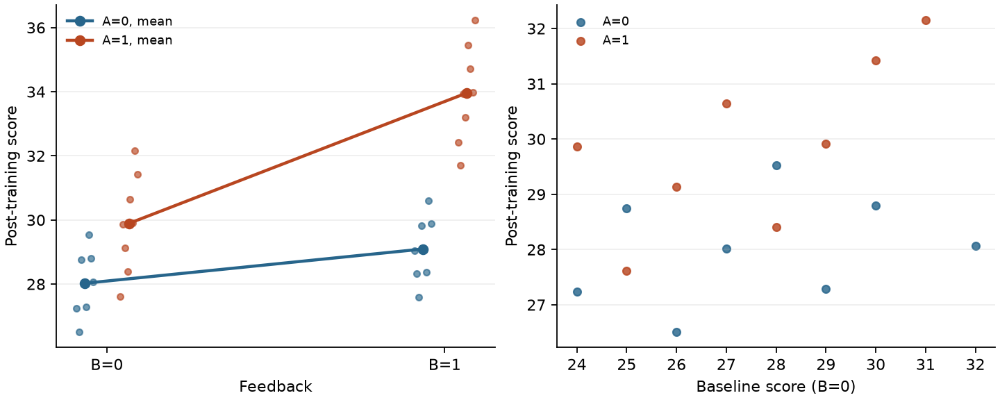

# M33 — از تعامل دو عامل تا مقایسهٔ رتبه‌ای با تعدیل خط پایه

فرض کنید برای آموزش یک مهارت آزمایشگاهی دو برنامهٔ تمرین داریم. هر برنامه می‌تواند با بازخورد معمول یا با بازخورد دیداری همراه شود. اگر بازخورد دیداری تنها در برنامهٔ دوم کمک زیادی کند، میانگین گرفتن از دو برنامه این تفاوت را پنهان می‌کند. برای دیدن آن لازم است «اثر بازخورد در هر برنامه» و تفاوت میان این دو اثر را جدا ببینیم.

[طرح و تعامل](#section-1) · [ART از روی داده](#section-2) · [روش SRH](#section-3) · [ANCOVA رتبه‌ای](#section-4) · [گزارش و عیب‌یابی](#section-5) · [کار عملی](#practice)

## ۱. پرسش را از دل جدول ۲×۲ بیرون بکشید

در [دادهٔ ساختگی](../data/practice.csv) هر ردیف یک کارآموز است. ستون `a` برنامهٔ تمرین و `b` نوع بازخورد است و هر دو کد ۰ یا ۱ دارند. `replicate` شمارهٔ محلی فرد در هر ترکیب، `baseline` امتیاز پیش از آموزش و `value` امتیاز بعد از آموزش است. در هر ترکیب هشت فرد متفاوت داریم. شمارهٔ محلی ۱ در چهار خانه به چهار فرد اشاره دارد. بنابراین در این کارگاه طرح مستقل و متوازن است.

| برنامه و بازخورد | معمول، B=0 | دیداری، B=1 | میانگین برنامه |
|---|---:|---:|---:|
| برنامهٔ A=0 | ۲۸٫۰۲۶۲۵ | ۲۹٫۰۹۳۷۵ | ۲۸٫۵۶۰۰۰ |
| برنامهٔ A=1 | ۲۹٫۸۹۱۲۵ | ۳۳٫۹۵۸۷۵ | ۳۱٫۹۲۵۰۰ |
| میانگین بازخورد | ۲۸٫۹۵۸۷۵ | ۳۱٫۵۲۶۲۵ | ۳۰٫۲۴۲۵۰ |

در برنامهٔ صفر، میانگین امتیاز با بازخورد دیداری `29.09375−28.02625=1.0675` واحد بالاتر است. در برنامهٔ یک، همین اختلاف `33.95875−29.89125=4.0675` است. اختلاف این دو اختلاف، ۳ واحد امتیاز، نمونهٔ توصیفی تعامل است. در نمودار، دو خط را با A به‌عنوان سری و B روی محور افقی رسم کنید. شیب خط A=1 بزرگ‌تر خواهد بود.

اثر اصلی B در طرح متوازن میانگین دو اختلاف بازخورد است و به ۲٫۵۶۷۵ می‌رسد. اثر اصلی A اختلاف میانگین دو برنامه روی دو وضعیت بازخورد، یعنی ۳٫۳۶۵، است. وقتی تعامل مهم است، میانگین‌گیری روی سطح عامل دیگر بخشی از داستان را پنهان می‌کند. ابتدا اختلاف‌ها را در هر سطح جدا ببینید.

در نمودار چپ هر نقطه یک کارآموز و خط‌ها میانگین‌های خانه‌اند. نمودار راست فقط افراد B=0 را نشان می‌دهد و برای وارسی هم‌پوشانی خط پایه به کار می‌رود.

**مکث کوتاه.** اگر هر دو برنامه با بازخورد دیداری دقیقاً ۴ امتیاز بهتر شوند، اثر اصلی B مثبت است و اختلاف دو اختلاف صفر می‌شود. همین کنترل کمک می‌کند اثر اصلی را با تعامل اشتباه نگیریم.

## ۲. هم‌تراز کردن و رتبه‌بندی با ART

در M32 رتبه‌های مشترک برای شماری گروه مستقل کافی بود. اینجا یک نمرهٔ بالا می‌تواند از اثر برنامه، اثر بازخورد یا ترکیب خاص آن دو بیاید. رتبه‌بندی خام این سهم‌ها را از هم جدا نمی‌کند. در `Aligned Rank Transform` یا ART برای هر اثر پاسخ جداگانه‌ای می‌سازیم. ابتدا پاسخ را برای همان اثر هم‌تراز می‌کنیم، سپس روی پاسخ هم‌تراز رتبه می‌سازیم.

### یک سطر را دستی جلو ببرید

برای سطر اول، Y برابر ۲۷٫۲۴، میانگین خانهٔ A=0/B=0 برابر ۲۸٫۰۲۶۲۵ و میانگین کل ۳۰٫۲۴۲۵ است. ماندهٔ نسبت به خانه `27.24−28.02625=−0.78625` است. اثر A برای سطح صفر، میانگین حاشیه‌ای A=0 منهای میانگین کل، یعنی `−1.6825` است. اثر B برای سطح صفر `28.95875−30.2425=−1.28375` است. به‌این‌ترتیب برای اثر A، عدد `−0.78625−1.6825=−2.46875` را به دست می‌آوریم. دو پاسخ دیگر را با همین منطق می‌سازیم.

    residual  = Y - cell_mean
    aligned_A = residual + mean_A - grand_mean
    aligned_B = residual + mean_B - grand_mean
    aligned_AB = Y - mean_A - mean_B + grand_mean

هم‌ترازی B در سطر اول ۲٫۰۷− و هم‌ترازی تعامل ۰٫۰۳۶۲۵− است. فرمول آخر را می‌توان «ماندهٔ خانه به‌علاوهٔ تعامل خانه» هم خواند. در این سطر تعامل خانه `28.02625−28.56−28.95875+30.24250=0.75` است و با مانده جمع می‌شود. برای هر خانه، همین سهم تعامل پیش از رتبه‌بندی ثابت است.

این محاسبه را برای هر ۳۲ سطر ادامه دهید. مجموع هر ستون هم‌تراز باید نزدیک صفر باشد. پیش از رتبه‌بندی، بررسی کنید در تحلیل عاملی **مقدارهای هم‌تراز** اثرهای غیرهدف نزدیک صفر هستند. برای نمونه در هم‌ترازی A، میانگین B=0 و B=1 باید نزدیک هم باشد و اختلاف دو اختلاف نیز نزدیک صفر. بعد از رتبه‌بندی ممکن است اثرهای غیرهدف دوباره ظاهر شوند. آزمون آن‌ها را از این مدل نمی‌خوانیم.

### سه پاسخ رتبه‌ای و سه سطر نتیجه

برای هر ستون هم‌تراز جداگانه رتبهٔ ۱ تا ۳۲ بسازید و برای تساوی‌ها میانگین جایگاه‌ها را بگیرید. مقدارهای هم‌تراز را پیش از رتبه‌بندی تا دقت ثابت گرد کرده‌ایم تا خطای ممیز شناور ترتیب تساوی عددی را عوض نکند. روی هر پاسخ رتبه‌ای مدل کامل `A + B + A×B` را برازش دهید. از مدل اول فقط A، از مدل دوم فقط B و از مدل سوم فقط A×B را بخوانید. برای هر اثر یک درجهٔ آزادی و برای مانده ۳۲−۴=۲۸ درجهٔ آزادی داریم.

| اثر | F از ستون هم‌تراز همان اثر | P |
|---|---:|---:|
| A | ۶۶٫۹۳۵۳ | ۶٫۶۲ × ۱۰⁻⁹ |
| B | ۳۹٫۵۹۳۸ | ۸٫۳۶ × ۱۰⁻⁷ |
| A×B | ۱۰٫۸۶۷۱ | ۰٫۰۰۲۶۶۴ |

آزمون تعامل نشان می‌دهد پاسخ به بازخورد میان دو برنامه یکسان به نظر نمی‌رسد. عدد F اختلاف سه‌امتیازی را اندازه نمی‌گیرد. آن اختلاف را از جدول مقدارهای اصلی گزارش کنید. برای مقایسهٔ رسمی چند خانه یا اثر ساده، مقایسهٔ برنامه‌ریزی‌شده با روش هم‌ترازی متناسب، مانند ART-C، و تعدیل مناسب لازم است. اجرای t روی رتبه‌های هم‌تراز تعامل، جای این روش را نمی‌گیرد.

این فرمول دستی برای چهار خانهٔ متوازن و افراد مستقل است. در طرح تکراری باید شناسه و ساختار وابستگی در مدل ثبت شود. در طرح نامتوازن، تعریف اثر حاشیه‌ای و مدل را با مستندات ARTool بررسی کنید. رتبه‌کردن داده، وابستگی افراد یا مشکل طراحی را برطرف نمی‌کند.

## ۳. رتبه‌های خام و آزمون Scheirer–Ray–Hare

SRH پاسخ اصلی را یک‌بار رتبه‌بندی می‌کند. از همین یک ستون رتبه، مجموع مربع‌های A، B و تعامل را می‌گیرد. برای طرح ۲×۲ متوازن می‌توان از جمع رتبه‌های وزن‌دار استفاده کرد. به سطح ۰ کد ۱− و به سطح ۱ کد ۱ بدهید. برای تعامل دو کد A و B را ضرب کنید. برای هر اثر، مجموع رتبه ضرب در کد را به توان دو برسانید و بر N تقسیم کنید. این فرمول به توازن وابسته است.

برای پاسخ رتبه‌ای خام، میانگین رتبه‌های چهار خانه در ترتیب ۰۰، ۰۱، ۱۰ و ۱۱ برابر ۷٫۲۵، ۱۳٫۱۲۵، ۱۷٫۲۵ و ۲۸٫۳۷۵ است. مجموع وزن‌دار تعامل `8×(7.25−13.125−17.25+28.375)=42` است. مجموع مربع تعامل `42²/32=55.125` می‌شود. مجموع مربع کل رتبه‌ها حول میانگین ۲۷۲۸ و واریانس نمونه‌ای آن‌ها `2728/31=88` است. پس `H تعامل=55.125/88=0.62642`. در SRH، H را با کای‌دو با درجهٔ آزادی همان اثر مقایسه می‌کنیم.

| اثر | H از رتبهٔ خام | P تقریبی |
|---|---:|---:|
| A | ۱۴٫۴۹۰۱ | ۰٫۰۰۰۱۴۱ |
| B | ۶٫۵۶۸۲ | ۰٫۰۱۰۳۸ |
| A×B | ۰٫۶۲۶۴ | ۰٫۴۲۸۷ |

در جدول معمول ANOVA روی رتبهٔ خام ممکن است برای تعامل `F≈1.883` ببینید. این خروجی از ماندهٔ مدل در مخرج استفاده می‌کند. SRH از واریانس کل رتبه‌ها استفاده می‌کند و P دیگری می‌دهد. وقتی ART برای تعامل P کوچک‌تر می‌دهد، این دو روش را همراه با فرض و هدف گزارش کنید. آزمون اصلی را بعد از دیدن نتیجه جابه‌جا نکنید.

## ۴. مقایسهٔ دو گروه پس از درنظرگرفتن خط پایه

در این بخش سؤال محدود است. فقط ۱۶ فردِ B=0 را برمی‌داریم و می‌پرسیم آیا جایگاه امتیاز بعد از آموزش در دو برنامه، پس از تعدیل رتبهٔ خط پایه، متفاوت است. ترتیب کار اهمیت دارد. ابتدا B=0 را جدا کنید و بعد داخل همان ۱۶ نفر رتبه‌ بسازید. اگر رتبه‌ها را پیش از جداکردن بسازید، فاصلهٔ رتبه‌ها با حضور ۱۶ فرد دیگر تغییر می‌کند.

خط پایهٔ گروه A=0 از ۲۴ تا ۳۲ و در گروه A=1 از ۲۴ تا ۳۱ است. هم‌پوشانی عددی وجود دارد. نمودار خط پایه در برابر پاسخ را برای هر گروه ببینید. خط پایه باید پیش از دریافت برنامه اندازه‌گیری شده باشد. اگر رابطهٔ خط پایه و پاسخ در دو گروه شیب کاملاً متفاوتی داشته باشد، یک شیب مشترک خلاصه‌ای ناکافی است.

۱. در ۱۶ ردیف، `baseline` و `value` را جداگانه رتبه‌بندی کنید. خط پایهٔ ۲۴ دوبار آمده و هر دو مقدار رتبهٔ ۱٫۵ دارند.
۲. رگرسیون رتبهٔ پاسخ روی رتبهٔ خط پایه را با عرض از مبدأ و بدون عامل A برازش کنید. شیب به ۰٫۳۷۱۴۷ و عرض از مبدأ به ۵٫۳۴۲۵ می‌رسد.
۳. پیش‌بینی رتبهٔ پاسخ را از رتبهٔ مشاهده‌شده کم کنید. در سطر اول، رتبهٔ پاسخ ۲ و رتبهٔ خط پایه ۱٫۵ است. پیش‌بینی `5.3425 + 0.37147×1.5≈5.8997` و مانده `−3.8997` است.
۴. میانگین ماندهٔ A=0 به ۲٫۸۹۸۲− و A=1 به ۲٫۸۹۸۲ می‌رسد. مجموع مربع بین گروه‌ها حدود ۱۳۴٫۳۹ و مجموع مربع درون گروه‌ها ۱۵۹٫۱۷ است. این کارگاه روش دوگامی Quade را با آزمون یک‌طرفهٔ ANOVA روی مانده‌ها پیاده می‌کند. برای ۱۶ فرد و دو گروه، `F(1,14)=11.8207` و `P=0.003998` به دست می‌آید.

در اینجا «یک‌طرفه» یعنی یک عامل گروه در ANOVA. آمارهٔ F خودش جهت بالاتر بودن گروه را نمی‌دهد و جهت را از میانگین مانده‌ها می‌خوانیم. اگر رتبهٔ پاسخ را مستقیم بر رتبهٔ خط پایه و گروه برازش دهید، مدل دیگری با درجهٔ آزادی ماندهٔ ۱۳ و P متفاوت دارید. اگر اختلاف امتیاز روی مقیاس اصلی هدف است، برآورد و فاصلهٔ اطمینان در واحد امتیاز را از مدل مناسب همان مقیاس بگیرید. Quade در M32 برای طرح بلوکی وزن دامنه می‌ساخت و در این بخش Quade برای تعدیل رتبهٔ هم‌متغیر به کار می‌رود.

## ۵. کنترل و گزارش

- پیش از محاسبه، فراوانی چهار خانه، کدهای ۰ و ۱، استقلال افراد و تعداد خط پایه‌های گمشده را کنترل کنید.
- کنار نمودار تعامل، نقطه‌های اصلی را نگه دارید تا نتیجهٔ رتبه‌ای را با پراکندگی و اختلاف امتیاز بخوانید.
- برای ART نزدیک صفر بودن جمع هم‌ترازها و اثرهای ناخواستهٔ پیش از رتبه‌بندی را وارسی کنید. برای SRH نام مخرج و مرجع کای‌دو را در یادداشت تحلیل بنویسید.
- در بخش تعدیل، شرط B=0، شمار ۱۶ نفر، رتبه‌بندی در زیرمجموعه و شیوهٔ ساخت مانده را ثبت کنید.

نمونهٔ گزارش. در طرح عاملی ۲×۲ با هشت فرد در هر خانه، اختلاف توصیفی اثر بازخورد میان دو برنامه ۳ امتیاز بود. آزمون ART برای تعامل `F(1,28)=10.87` و `P=0.0027` داد. در مقایسهٔ جداگانهٔ ۱۶ فرد با B=0، آزمون مانده‌های رتبه‌ای تعدیل‌شده بر اساس خط پایه `F(1,14)=11.82` و `P=0.0040` داد. برای اندازهٔ کاربردی اثر، اختلاف خام و تغییرهای خط پایه کنار نتیجه نشان داده می‌شوند.

## کار عملی

[۳۰ تمرین](../exercises/module.md) · [پاسخ‌های تشریحی](../solutions/module.md) · [دادهٔ خام](../data/practice.csv)

[Excel](../excel/MODULE.md) · [SPSS](../spss/MODULE.md) · [GraphPad Prism](../prism/MODULE.md) · [R](../r/MODULE.md) · [Python](../python/MODULE.md)

[منابع و فیلم‌ها](../references.md) · [اعتبارسنجی](../VALIDATION.md) · [واژه‌نامهٔ دوره](../../../resources/glossary.md)

[درس پیش، M32](../../M32-kruskal-friedman-k-groups/lessons/README.md) · [درس بعد، M34](../../../phase-06-categorical/M34-one-proportion-goodness-of-fit/lessons/README.md)

