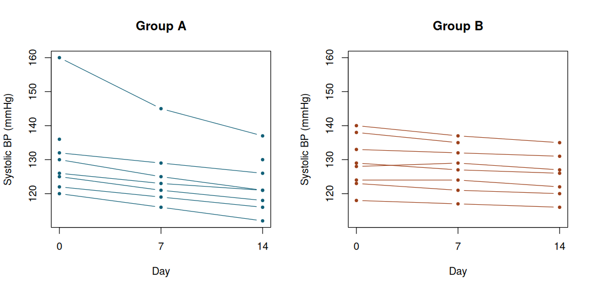

# ۸.۳ — پیگیری زمانی و جدول ۱ مقاله

برای فرد ۷، فشار روز صفر ۱۳۶ و فشار روز ۱۴ برابر ۱۳۰ mmHg است. روز ۷ ثبت نشده است. شیب مسیر بین دو مقدار ثبت‌شده به‌تنهایی فشار روز ۷ را تعیین نمی‌کند.

## مقدماتی

در **نمودار خطی** محور افقی زمان است. برای دیدن پیگیری فردی، تنها نقطه‌های همان فرد را با خط به هم وصل کنید. در این تمرین برای نوبت گمشده شکاف بگذارید تا نوبتِ بدون اندازه‌گیری پیدا باشد.

## متوسط

کنار خلاصهٔ هر روز، شمار مقدارهای موجود را بنویسید. تفاوت میانگین روز صفر و روز ۱۴ وقتی شمار افراد متفاوت است، از تغییر میانگین در افراد دارای هر دو اندازه‌گیری جداست. برای خلاصهٔ تغییر زوجی، ابتدا در هر فرد روز صفر را از روز ۱۴ کم کنید، سپس تغییرها را خلاصه کنید.

## پیشرفته

**جدول ۱** ویژگی‌های آغاز مطالعه را به تفکیک گروه گزارش می‌کند. در این نمونه برای سن و فشار آغازین میانگین و انحراف معیار نمونه‌ای را با مقیاس بنویسید. برای متغیر کیفی شمار و درصد با مخرج روشن بیاورید و دادهٔ گمشده را جدا ثبت کنید. روزهای ۷ و ۱۴ پیامد پیگیری‌اند و در جدول جداگانه گزارش می‌شوند.

| ویژگی آغاز | A، ۸ نفر | B، ۸ نفر |
|---|---:|---:|
| سن، میانگین (SD)، سال | ۴۹٫۵ (۱۴٫۹) | ۵۰٫۹ (۱۴٫۷) |
| فشار سیستولی، میانگین (SD)، mmHg | ۱۳۱٫۴ (۱۲٫۷) | ۱۲۹٫۱ (۷٫۶) |

[درس پیش](L2-groups-and-relationships.md) · [تمرین‌ها](../exercises/README.md)

## نمونهٔ حل‌شده

**گزارش زوج‌ها.** در گروه B، اختلاف دو میانگین روز صفر و ۱۴ منفی ۳٫۸۴ است. وقتی نخست افراد دارای هر دو اندازه را انتخاب و تغییر هر نفر را حساب کنیم، میانگین تغییر منفی ۲٫۵۷ است. گزارش دوم مخرج ۷ زوج دارد.

[۳۰ تمرین سطح‌بندی‌شده و حل‌ها](../exercises/L3.md)

## کار با نرم‌افزار

ابتدا [کارگاه عملی این ماژول](../software-workshop.md) را باز کنید تا فایل و محیط را آماده کنید. سپس خروجی نمونه را با این بخش بسنجید.

**خروجی برای مقایسه.** برای گروه B شمارهای معتبر ۸، ۸ و ۷ است.

Excel

ستون‌های day0 تا day14 را برای هر فرد یک سری بگیرید. خانهٔ خالی را Gap بگذارید. شمار معتبر را با COUNT و SD آغاز را با STDEV.S گزارش کنید.

SPSS

در Restructure، day0 تا day14 را به یک ستون فشار و یک شاخص نوبت تبدیل کنید و id را نگه دارید. در نمودار چندخطی، نوبت را X و شناسه را سری بگیرید. در جدول خلاصه تعداد فشارهای غیرگمشده را با شمارش فشار بسنجید.

GraphPad Prism

از XY با X برابر ۰، ۷ و ۱۴ و یک Y برای هر فرد کمک بگیرید. فرد ۷ را با خانهٔ خالی روز ۷ وارد کنید. شمار معتبر و خلاصهٔ شروع مطالعه را برای ستون‌های روز صفر جدا بخوانید.

فیلم کمکی. [GraphPad، فیلم‌های شروع کار با Prism](https://www.graphpad.com/series/getting-started-in-prism) — مقدماتی. سراغ بخش ورود داده و رسم نمودار بروید.

R

`colSums(!is.na(subset(d, group=="B")[c("day0","day7","day14")]))` را اجرا کنید. شکل کامل در اسکریپت ماژول آمده است.

Python

`d.loc[d.group.eq("B"), ["day0","day7","day14"]].count()` را بخوانید. برای هر سطر یک خط رسم کنید و NaN را در بردار Y نگه دارید.

## خواندن و دیدن

[فیلم‌ها و مراجع نوشتاری هر پنج نرم‌افزار](../references.md#software-media)

- OpenStax، بخش Encoding Data That Change Over Time.
- [Khan Academy، نمودار خطی](https://www.khanacademy.org/math/statistics-probability/summarizing-quantitative-data/line-graphs/v/line-graphs) — مقدماتی. محور زمان و تفسیر شیب را ببینید.

[درس بعد](../../../phase-2-probability/M09-probability-bayes/lessons/L1-events.md)
