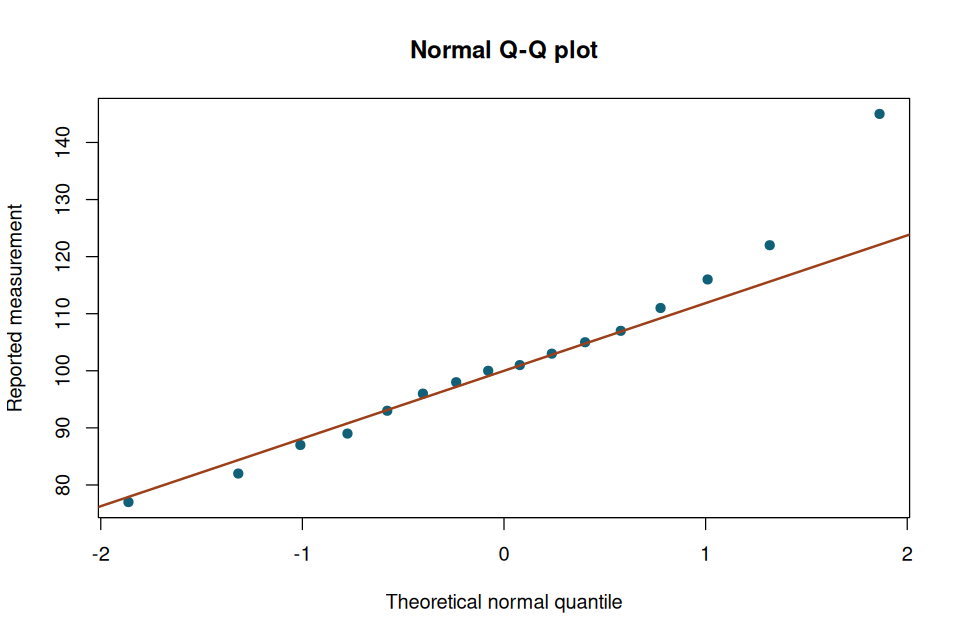

# ۱۱.۳ — توزیع مرجع و نمودار Q-Q

## مقدماتی

در نمودار Q-Q، صدک‌های نظری را روی محور افقی و داده‌های مرتب را روی محور عمودی می‌گذاریم. اگر شکل داده به نرمال نزدیک باشد، نقطه‌ها در حدود یک خط می‌افتند. در نمونهٔ کوچک این داوری با نوسان همراه است.

## متوسط

در نمونهٔ مستقل نرمال، وقتی SD جامعه معلوم نیست، آمارهٔ `(mean − μ)/(s/sqrt(n))` توزیع t با n−1 درجه آزادی دارد. t از نرمال دنباله‌های سنگین‌تری دارد و با افزایش درجهٔ آزادی به آن نزدیک می‌شود. برای ۱۰ نفر، صدک ۹۷٫۵ توزیع t با ۹ درجه آزادی حدود ۲٫۲۶۲ است.

## پیشرفته

جمع مربع‌های k نرمال استاندارد مستقل، کای‌دو با k درجه آزادی است. در نمونهٔ نرمال مستقل، `(n−1)s²/σ²` کای‌دو با n−1 درجه آزادی دارد. تقسیم دو کای‌دوی مستقل که هر کدام بر درجهٔ آزادی خود تقسیم شده‌اند، F می‌دهد. F دو درجهٔ آزادی دارد و ترتیب آن‌ها مهم است.

در Q-Q خمیدگی نظام‌مند را کنار هیستوگرام و زمینهٔ اندازه‌گیری بررسی کنید. خروج از خط برای یک نقطه می‌تواند نشانهٔ مقدار دورافتاده باشد. اگر مدل دربارهٔ مانده‌ها فرض نرمال دارد، مانده‌ها را بررسی کنید. بررسی نمودار مکمل بررسی استقلال و دیگر فرض‌هاست.

[درس پیش](L2-positive.md) · [تمرین‌ها](../exercises/README.md)

با [۱۶ مقدار ساختگی](../data/M11_measurements.csv) نمودار زیر را بسازید. مقدار ۱۴۵ در گوشهٔ بالا از خط مرجع دور می‌شود. در یک تحلیل واقعی، پیش از هر تصمیمی دربارهٔ حذف، ثبت و زمینهٔ اندازه‌گیری را بررسی کنید.

## نمونهٔ حل‌شده

**خواندن درجهٔ آزادی F.** اگر صورت از نمونهٔ ۸ نفری و مخرج از نمونهٔ ۱۲ نفری آمده و شرایط نرمال، استقلال و برابری واریانس جامعه برقرار است، F درجه‌های ۷ و ۱۱ دارد. برای نسبت وارون، ترتیب درجه‌ها ۱۱ و ۷ است.

[۳۰ تمرین سطح‌بندی‌شده و حل‌ها](../exercises/L3.md)

## کار با نرم‌افزار

ابتدا [کارگاه عملی این ماژول](../software-workshop.md) را باز کنید تا فایل و محیط را آماده کنید. سپس خروجی نمونه را با این بخش بسنجید.

**خروجی برای مقایسه.** صدک t با ۹ درجهٔ آزادی حدود ۲٫۲۶۲ است. شکل نقاط Q-Q را جدا بررسی کنید.

Excel

`=T.INV(0.975,9)` را وارد کنید. داده را مرتب و `NORM.S.INV((i-0.5)/n)` را برای رتبهٔ i حساب کنید. این صدک را X و داده را Y بگذارید.

SPSS

در Compute Variable از `IDF.T(.975,9)` برای صدک کمک بگیرید. در Explore نمودار نرمال را برای ستون عددی درخواست کنید.

GraphPad Prism

در XY، نمرهٔ نرمال نظری و مقدار مرتب‌شده را وارد کنید. برای منحنی‌های مرجع، راهنمای GraphPad «Plotting t, z, F, or chi-square distributions» را دنبال کنید.

R

`qt(.975,9)`. برای بردار x از `qqnorm(x); qqline(x)` کمک بگیرید.

Python

`from scipy.stats import t, probplot` سپس `t.ppf(.975,9)` و `probplot(x, dist="norm", plot=plt)`.

## خواندن و دیدن

[فیلم‌ها و مراجع نوشتاری هر پنج نرم‌افزار](../references.md#software-media)

- NIST/SEMATECH، بخش Normal Probability Plot.
- [StatQuest، نمودار Q-Q](https://www.youtube.com/watch?v=okjYjClSjOg) — متوسط. ساخت صدک‌های نظری و خواندن شکل نقاط را دنبال کنید.

[درس بعد](../../M12-sampling-distribution-clt/lessons/L1-sampling.md)
