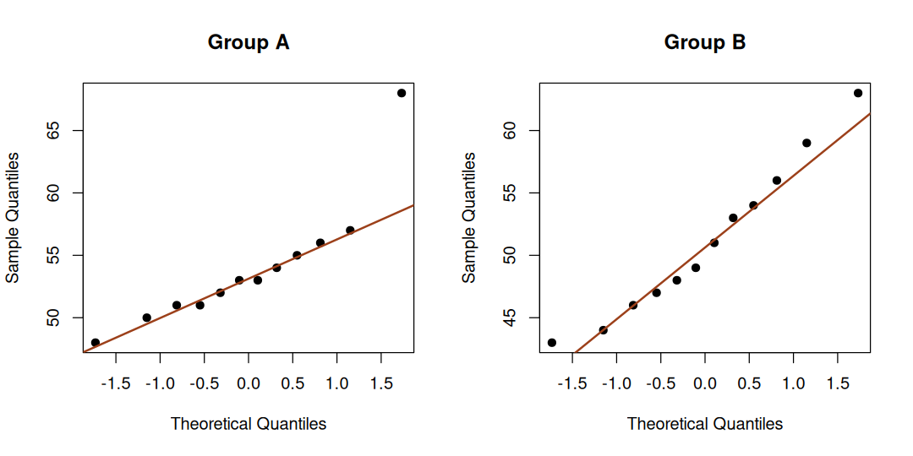

# 16.1 — نرمال‌بودن، Q-Q و چند آزمون

در گروه A، آخرین سنجه ۶۸ و دیگر مقدارها بین ۴۸ و ۵۷ هستند. پیش از انتخاب مدل، بررسی می‌کنیم الگو به کیفیت ثبت یا به توزیع سنجه مربوط است.

## مقدماتی

اول تعیین کنید فرض نرمال دربارهٔ چیست. در t زوجی، اختلاف‌های زوجی را ببینید. در مدل رگرسیون، ساختار مانده‌ها مهم است. هیستوگرام و Q-Q را همراه دادهٔ خام بخوانید.

## متوسط

Shapiro–Wilk از داده‌های مرتب برای سنجش نرمال‌بودن بهره می‌گیرد. آزمون معمول Kolmogorov–Smirnov نیاز دارد توزیع مرجع و پارامترهای آن از پیش معلوم باشند. وقتی میانگین و SD از همین داده برآورد شده‌اند، برای نسخهٔ نرمال از کالیبراسیون Lilliefors کمک بگیرید.

## پیشرفته

Anderson–Darling به دنباله‌ها وزن بیشتری می‌دهد و کالیبراسیون آن به توزیع و نحوهٔ برآورد پارامتر وابسته است. D’Agostino–Pearson با چولگی و کشیدگی کار می‌کند و برای نمونهٔ خیلی کوچک مناسب نیست. P بزرگ نرمال‌بودن را ثابت نمی‌کند. با n بزرگ، انحراف کوچک هم می‌تواند آشکار شود.

## نمونهٔ حل‌شده

در A، Shapiro–Wilk مقدار W≈۰٫۸۱۵ و P≈۰٫۰۱۴ می‌دهد. در Q-Q مقدار ۶۸ را با پروندهٔ ساختگی و شیوهٔ تولید داده بسنجید. نتیجهٔ آزمون به‌تنهایی حکم حذف یا تغییر آزمون نمی‌دهد.

در گروه A نقطهٔ ۶۸ در سمت راست و بالای خط مرجع دیده می‌شود.

## تمرین عملی

در [کارگاه گام‌به‌گام](../software-workshop.md#lesson-1) تمرین همین درس را در نرم‌افزار انتخابی انجام دهید. [۳۰ تمرین سطح‌بندی‌شده](../exercises/L1.md) نیز پاسخ جداگانه دارند.

## خواندن و دیدن

- [NIST، Anderson–Darling](https://www.itl.nist.gov/div898/handbook/eda/section3/eda3e.htm)
- [StatQuest، نمودار Q-Q](https://www.youtube.com/watch?v=okjYjClSjOg) — مقدماتی تا متوسط. ساخت صدک نظری و خواندن انحنا را ببینید.
- [فیلم و مرجع پنج نرم‌افزار](../references.md#software-media)

[درس بعد](L2.md)

[ماژول پیش](../../M15-effect-size-power/lessons/L3.md)
